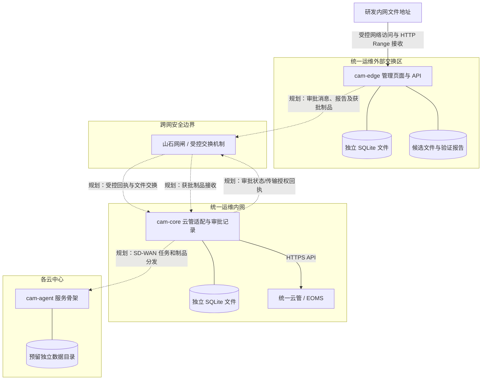
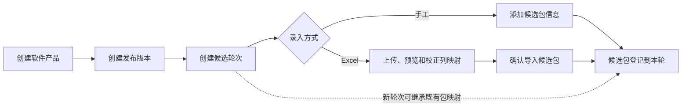
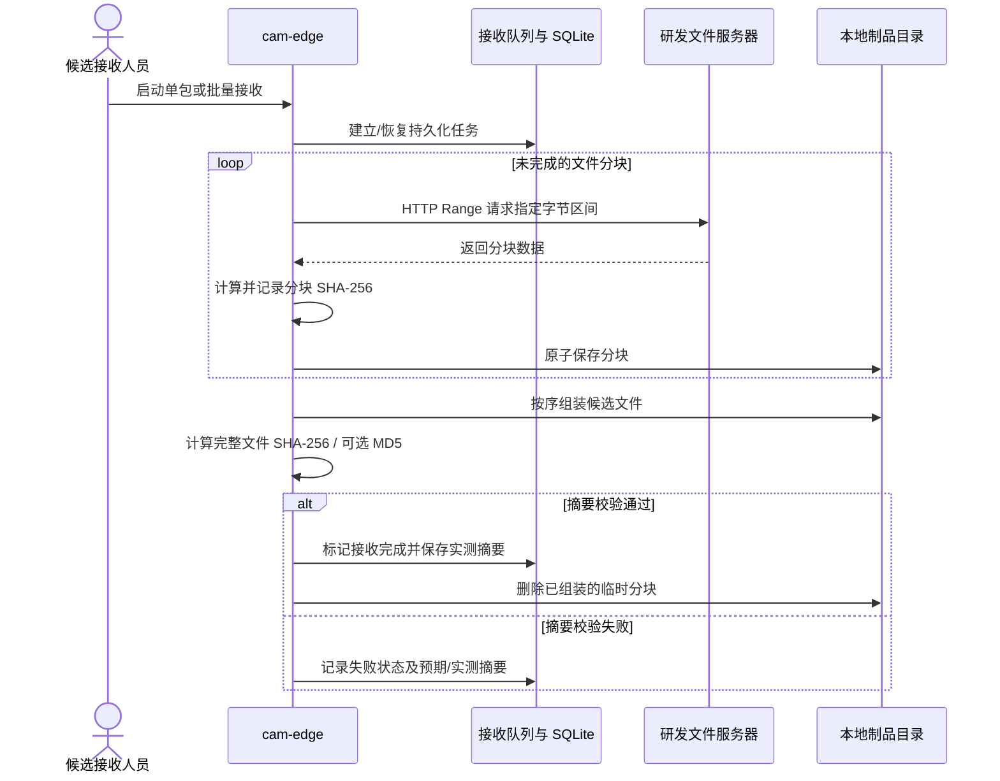
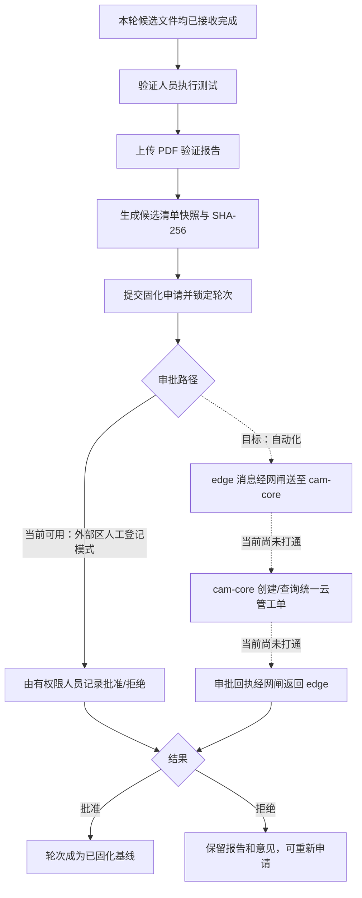

# 云平台软件制品管理辅助工具及管理流程说明

**工具名称：** 云平台软件制品管理辅助工具（Cloud Artifact Management，CAM）
**工程名：** `cloud-artifact-management`
**文档用途：** 供测评机构了解工具定位、软件制品管理流程、工具边界和当前建设状态
**状态说明：** 本文按当前代码实现编写；规划能力单独标明，不作为当前已投产能力的证明。

## 1. 工具定位

CAM 是供统一运维使用的软件制品管理辅助工具，用于支撑云平台软件制品从研发候选包接收、验证、报告留存，到后续审批、跨安全区传输和云中心分发的管理过程。工具以软件产品、发布版本、候选轮次和候选包组织材料，并记录接收任务、文件摘要、验证报告、下载授权及相关操作。

建设目的，是让研发提供的下载地址不再直接成为各云中心运维人员的部署来源。候选文件先由统一运维接收并校验，在完成验证和审批后再进入内网受控交付流程；每个阶段保留对应记录，便于追溯“哪个版本、哪一轮、哪些文件、由谁验证和批准、文件摘要是什么”。

当前版本已经具备外部交换区候选制品管理、断点续传接收、账号权限、下载交付和验证报告/轮次固化记录，以及 `cam-core` 云管工单适配模块。外部区与内网 `cam-core` 的网闸消息交换、经审批后实际传输制品，以及云中心接收分发仍在建设中。本文不会把目标架构描述成已经贯通的生产流程。

CAM 的职责边界是“记录、校验和支撑交付”。它不替代研发构建和发布平台，不替代统一云管的 AAA 认证、工单审批和变更流程，不替代山石网闸的安全策略，不直接执行云平台升级，也不独立决定正式发布。正式审批、跨域放行和云平台升级仍由既有平台、管理制度及责任人员完成。

## 2. 工具边界与部署分区

工具按安全职责划分为三个逻辑区域部署。安全区域之间的网络通道和审批由既有网闸、统一云管及网络设施承担；CAM 组件通过受控接口与其协作。

图中的实线表示当前代码具有相应功能或接口；虚线表示设计目标或尚未贯通的连接。具体而言：

- `cam-edge` 是当前主要业务界面及外部区 API，管理候选产品、发布版本、轮次、候选包、下载授权和固化申请记录。
- `cam-core` 在内网侧保存审批关联数据，并通过服务凭据调用统一云管工单接口。它提供受控交换 API，但目前网闸与 `cam-edge` 之间的现场文件/消息交换流程尚未集成完成。
- `cam-agent` 当前仅启动通用服务和健康检查，是后续云中心接收、缓存、校验和回报能力的服务骨架；尚未实现 SD-WAN 制品拉取和中心缓存交付。
- 已实现的 `cam-edge` 和 `cam-core` 各自使用独立 SQLite 数据库文件。`cam-edge` 同时在本地数据目录保存已接收候选文件、分块和验证报告；`cam-agent` 尚未实现业务数据持久化。
- 软件运行可采用 Docker Compose 部署。容器化本身不代表安全区隔离已经由 CAM 实现；网络隔离由实际部署的网闸和网络策略提供。

## 3. 参与角色与职责

| 角色 | 在流程中的职责 | 当前工具支持情况 |
|---|---|---|
| 研发发布人员 | 在既有研发流程中提供候选文件地址、版本资料和声明摘要 | CAM 不管理研发构建或研发发布流程 |
| 候选接收人员 | 建立产品/版本/轮次信息，登记来源地址并接收候选文件 | 外部区本地账号及角色控制已实现 |
| 验证人员 | 检查候选包，记录结论并提交验证报告 | 轮次报告上传及摘要固化记录已实现；实际测试活动由验证人员执行 |
| 发布申请/审批人员 | 审核验证结果和发布申请，避免申请人自批 | 外部区固化记录支持角色分离；`cam-core` 云管工单适配已实现，自动贯通仍在建设 |
| 统一云管审批处理人 | 在统一云管工单中处理审批及确认 | 由统一云管负责身份认证和工单流转 |
| 云中心运维人员 | 在中心侧接收获批制品，并按既有变更流程执行升级 | CAM 中心接收与升级执行联动尚未实现 |
| 工具管理员/审计人员 | 维护账号配置并查询管理记录 | 外部区账号管理和相关审计记录已实现；跨区集中审计尚未实现 |

外部交换区使用独立本地人员账号，不复用统一云管账号。内网云管审批使用 `cam-core` 服务身份调用接口，审批人的身份和审批动作由统一云管自身认证及记录。服务身份不能代替审批人。

## 4. 软件制品管理业务流程

### 4.1 建立发布版本和候选轮次

接收人员先建立软件产品，再为产品建立发布版本，并在该版本下建立候选轮次。轮次代表一次候选收集与验证基线。后续轮次可以继承上一轮的包映射；如某个包有更新，只在新轮次替换该包，其余候选包继续引用继承项。继承不会复制大文件。

每个候选包记录来源 URL、文件名、软件版本、架构、期望摘要等资料。文件名未填写时可从 URL 推导；版本未填写时使用发布版本。也可通过 Excel 清单导入候选包：先预览、调整列映射和检查错误，再确认导入；导入不会自动开始接收。

### 4.2 接收候选文件及完整性校验

候选包登记后，接收人员可单包接收或批量接收本轮未完成包。工具服务端将任务放入持久化队列，按配置并发下载。当前接收实现要求来源服务器支持 HTTP Range；接收中断或服务重启后，工具根据已完成分块继续获取缺失内容。

每个分块独立计算 SHA-256 并记录大小与偏移。文件组装后重新计算完整文件 SHA-256；如提供了期望 SHA-256 或 MD5，则与实测值比对。摘要不匹配时，文件不会进入已完成状态，错误信息记录预期值和实测值。组装成功后，临时分块目录会清理，数据库保留分块摘要及接收状态记录。

外部区的来源 allowlist 限制候选 URL 的主机名或 IP；具体端口和路由由 URL、主机网络及部署策略共同决定。接收完成和摘要匹配只能证明收到的字节与记录的摘要一致，不等同于恶意代码扫描、签名验签或软件安全认证。当前应用没有实现制品签名、病毒扫描或沙箱检测。

### 4.3 验证、报告和轮次固化

验证人员基于接收完成的候选文件开展部署、兼容性和功能验证。CAM 提供验证报告登记能力：报告包含标题、结论、验证环境及 PDF 文件；工具计算报告 SHA-256。创建固化申请时，CAM 展开本轮继承映射并生成候选清单快照和清单 SHA-256。该轮所有候选必须接收完成并具有实测 SHA-256 才可申请固化。

申请提交后轮次候选映射锁定。固化记录保存申请人、报告摘要、候选清单快照、审批引用信息和状态，并限制申请人批准自己的申请。被拒绝的申请及意见保留，轮次可重新提交新的固化申请。

当前需注意：外部区已实现固化记录、报告文件和申请 outbox 消息生成；`cam-core` 已实现接收审批申请、创建云管工单、查询状态、验证批准清单摘要及确认关单的适配接口。但 edge outbox、网闸实际交换、core 状态回执和 edge 页面状态之间仍未形成自动端到端闭环。生产环境可设置 `CAM_APPROVAL_MODE=cloud` 禁用外部区本地人工批准入口；这本身不能证明网闸联动已启用。云管工单的真实现场连通和全流程验证也尚未完成。

### 4.4 验证人员下载交付

对已完成候选包，可创建受限下载授权，绑定验证人员账号、候选文件范围、有效期和总次数/单文件次数限制。工具保存 Token 摘要而非 Token 原文，并记录授权、会话、来源地址、客户端和已发送/覆盖字节等下载状态。下载接口支持 HTTP Range，供浏览器或测试服务器等下载客户端续传；并发传输由授权额度和服务端控制。

下载授权用于验证阶段的受控文件交付，不能代替审批后的跨安全区正式发布。授权使用次数依据系统下载会话的服务端状态判定，不以页面打开次数简单计数。

### 4.5 内网接收、云中心分发和升级

目标流程是：统一云管审批通过后，外部交换区只将与审批清单摘要匹配的制品提交网闸；内网侧再次核验任务关联、摘要和目标安全域，登记为内网正式制品；随后 `cam-core` 编排中心任务，中心 `cam-agent` 通过 SD-WAN 获取制品并在本地校验。中心升级服务器将已授权文件交给现有云平台升级程序，中心运维仍按原有变更授权执行升级并回报结果。

上述流程是总体目标，并非当前工具已具备的端到端交付能力。当前尚未实现正式制品库、网闸文件双向交换适配、清单签名与验签、SD-WAN 中心拉取、中心缓存校验以及控制节点升级结果回报。现阶段不应将 CAM 描述为已经执行云中心软件升级。

## 5. 当前实现与建设状态

| 能力 | 当前状态 | 说明 |
|---|---|---|
| 软件产品、发布版本、候选轮次、继承包映射 | 已实现 | 外部区 SQLite 持久化；支持产品/版本/轮次筛选与管理 |
| 手工登记候选包、Excel 预览导入 | 已实现 | 可映射常见清单列并逐行预览；仅创建候选登记，不自动下载 |
| 来源 allowlist、后台接收队列、暂停/恢复 | 已实现 | 要求源站支持 HTTP Range；队列信息和分块进度持久化 |
| 分块 SHA-256、完整文件 SHA-256、期望摘要核对 | 已实现 | 组装完成清理临时分块；不提供数字签名或恶意代码扫描 |
| 外部区账号、角色权限、会话和账号审计 | 已实现 | 独立本地账号；基于 API 入口统一认证与 RBAC |
| 验证人员下载授权及 HTTP Range 下载 | 已实现 | 授权与账号、文件、次数、期限关联；有下载会话和日志记录 |
| PDF 验证报告、清单快照和轮次固化记录 | 已实现 | 报告/清单摘要被记录；生产云管审批模式下拒绝本地人工批准接口 |
| `cam-core` 统一云管/EOMS 工单适配 | 已实现代码和接口测试 | 支持动态读取字典并按配置语义匹配、创建/查询/确认工单；现场生产联调未完成 |
| edge–网闸–core 自动审批消息闭环 | 部分实现/未贯通 | edge 能生成审批 outbox；core 有受控 API；网闸规则、搬运和回执消费尚未集成 |
| 审批通过后网闸传输制品至内网正式库 | 未实现 | 没有自动跨区传输和正式制品库登记流程 |
| 签名密钥、清单签名和接收端验签 | 未实现 | 当前摘要用于完整性校验，不构成来源身份签名 |
| `cam-agent` SD-WAN 下载、缓存和控制节点交付 | 未实现 | `cam-agent` 当前为服务/健康检查骨架 |
| 中心升级执行、回滚和结果回报 | 未实现 | 由既有运维操作和升级程序承担，CAM 尚未集成 |
| 集中不可篡改审计、恶意代码扫描 | 未实现 | 当前有应用账号/操作和下载记录及容器日志，尚未构成不可篡改集中审计体系 |

“已实现”表示当前代码存在相应功能并配有自动化测试，不表示所有安全域的现场部署、配置、云管联调、网闸验证或生产验收已经完成。实际上线能力以具体部署清单、网络策略、账户和联调记录为准。

## 6. 安全与可追溯控制

当前代码中与制品管理直接相关的控制包括：

- 外部区业务 API 要求已登录账号，并根据角色限制接收、验证报告和下载授权等操作；外部人员账号不与统一云管账号混用。
- 候选来源受 URL 主机 allowlist 限制；接收文件按 HTTP Range 分块，记录分块摘要并对组装文件重新计算 SHA-256。
- 候选制品、发布版本和轮次在业务记录中关联；新轮次继承候选映射而非复制文件，固化时生成轮次清单快照。
- 验证报告按 PDF 文件头和大小限制校验，文件及清单分别计算 SHA-256；申请提交后轮次锁定，避免申请过程中候选映射变化。
- 下载 Token 以摘要形式存储，授权限定接收人、文件、有效期和次数；下载支持 Range 并记录服务端下载会话进度。
- `cam-core` 工单创建使用服务端配置的身份凭据；工单字段映射优先从当前云管查询字典并按语义匹配，不固定环境相关数字 ID；审批状态要求与关联工单、已批准的清单 SHA-256 对应后才接受转运授权记录。
- SQLite 文件放在部署主机配置的本地持久化目录中，不依赖容器可写层保存业务数据；运行日志采用容器日志机制。

这些控制不应被解释为已达到特定等级保护、密码应用、软件供应链安全认证或第三方测评结论。当前工具尚无清单数字签名、制品恶意代码扫描、不可变审计存储、网闸接收端验签及中心端二次校验等目标控制；需按正式测评范围和部署环境继续建设并验证。

## 7. 技术与运行概况

- 应用服务采用 Node.js 24、Fastify 和原生 JavaScript ES Modules。
- Web 管理界面使用 AdminLTE 4、Bootstrap 5 和原生 JavaScript，不使用前端框架。
- `cam-edge` 和 `cam-core` 使用 Node.js 内置 SQLite，数据库文件相互独立；候选制品和报告存储在主机持久化目录中。`cam-agent` 尚未接入 SQLite 业务存储。
- 通过 Docker 镜像和 Docker Compose 部署；容器以非 root 用户运行、根文件系统只读，并通过绑定挂载保存数据。
- `cam-edge`、`cam-core` 和 `cam-agent` 以独立服务运行；小规模测试可合并部署到同一虚拟机，但生产安全区应根据隔离边界分别部署。
- 配置与密钥通过部署环境文件或受控 Secret 注入，不应写入代码仓库、镜像或业务日志。

## 8. 相关设计资料

- [总体设计](system-design.md)：目标业务架构、职责边界和总体设计。
- [技术方案](technical-solution.md)：服务、接口、存储、部署和安全实现约束。
- [外部交换区账号及下载交付](edge-accounts.md)：外部区本地账号和下载授权细节。
