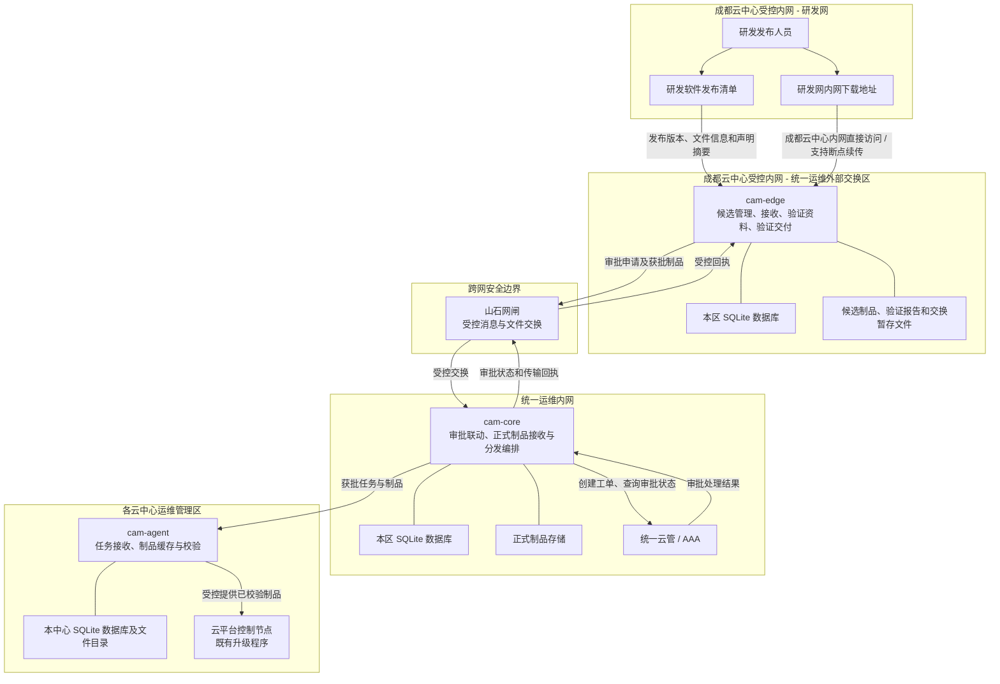
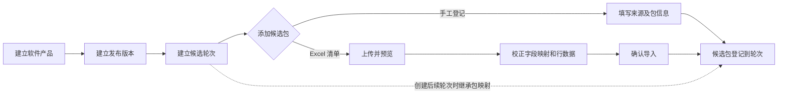
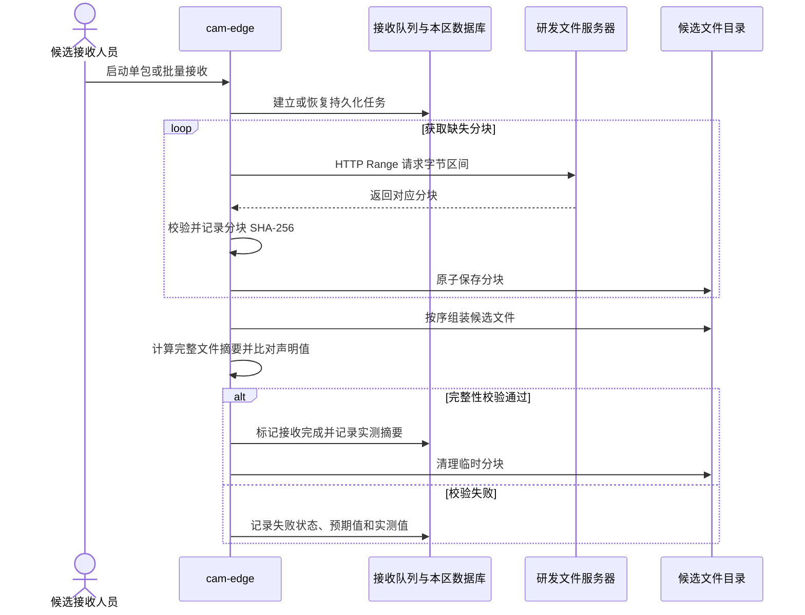
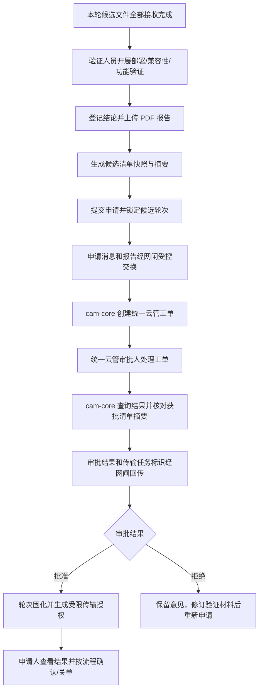
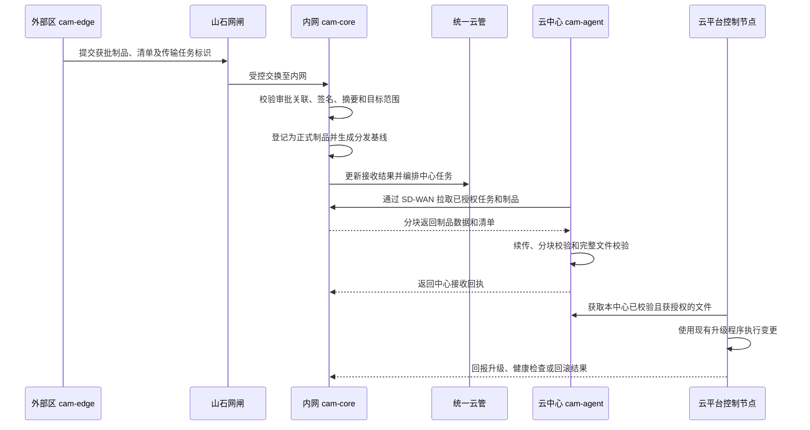

# 云平台软件制品管理辅助工具及管理流程说明

- **工具名称：** 云平台软件制品管理辅助工具（Cloud Artifact Management，CAM）
- **工程名：** `cloud-artifact-management`
- **文档用途：** 说明工具的目标定位、管理流程、职责边界和运行方式
- **设计口径：** 本文描述工具建成后的目标形态和管理流程。

## 1. 工具定位

CAM 是供统一运维使用的软件制品管理辅助工具，用于支撑云平台软件制品从研发候选包接收、验证、报告留存，到审批、跨安全区传输和云中心分发的管理过程。工具以软件产品、发布版本、候选轮次和候选包组织材料，并记录接收任务、文件摘要、验证报告、下载授权及相关操作。

建设目的，是让研发提供的下载地址不再直接成为各云中心运维人员的部署来源。候选文件由统一运维从成都云中心内网的研发下载地址集中接收和校验，验证人员完成验证并形成报告，审批通过后再进入内网受控交付流程。各阶段保留关联记录，便于追溯产品版本、候选轮次、文件摘要、验证责任人、审批结果和交付状态。

CAM 负责记录软件制品的来源、版本、接收、验证和交付信息，校验文件完整性，并支撑候选包接收、验证报告提交、审批联动和受控分发。研发构建与研发发布由研发平台和研发人员负责；人员身份认证、工单审批及变更审批由统一云管和 AAA 提供；跨安全区文件交换由山石网闸执行；云平台升级由运维人员通过现有升级程序实施。CAM 将这些环节的业务记录与制品摘要关联起来，形成可追溯的交付过程。

## 2. 工具边界与部署分区

工具按安全职责部署在统一运维外部交换区、统一运维内网和各云中心。安全区域之间的网络通道和审批由既有网闸、统一云管及网络设施承担；CAM 组件通过受控接口与其协作。

各区域职责如下：

- **统一运维外部交换区：** 通过成都云中心内网访问研发文件地址，维护候选产品、发布版本、候选轮次和候选包；接收候选文件、校验摘要、保存验证材料，并向验证人员提供受限下载交付。
- **跨网安全边界：** 山石网闸负责安全域隔离和受控消息/文件交换。审批控制消息与大文件数据按交换策略分别处理，保持制品内容与审批清单摘要一致。
- **统一运维内网：** `cam-core` 对接统一云管，依据审批结果控制制品接收和传输授权；保存正式制品及其版本、审批和接收关联记录，并编排云中心分发任务。
- **各云中心：** 每个中心或隔离安全域部署独立 `cam-agent`，接收分发任务、获取制品、校验并缓存，再向本中心控制节点提供受授权文件。不同安全域不共用服务身份或缓存。

### 2.1 研发发布来源与网络关系

研发测试团队按既有研发发布流程完成软件包发布，并提供软件发布清单和研发网内网下载地址。发布清单用于说明产品版本、包名称、架构、文件大小及研发声明摘要等信息；下载地址指向研发网内的制品文件。

统一运维中心外部交换区与研发网位于成都云中心同一受控内网环境，网络路由可达时，`cam-edge` 通过内部网络直接从研发下载地址拉取文件，无需经过互联网或 VPN。访问仍按网络分区、访问控制策略和来源 allowlist 管理，仅开放所需的源地址、目标地址及服务端口。研发网与外部交换区的业务管理职责保持独立，内部网络可达不改变候选文件需经过统一运维接收、校验和验证的流程。

研发侧清单和下载位置可能随研发发布更新。CAM 在每次接收时保存对应的产品版本、文件名、来源地址、声明摘要和实测摘要等快照；后续研发侧更新不会覆盖已接收的候选文件及其记录。验证过程中需要替换文件时，在新的候选轮次或候选记录中重新接收，并保留与原候选的关联。

外部区和内网各自使用独立的 SQLite 数据库文件及本地持久化文件目录；云中心维护自己的任务数据库和制品缓存。安全区之间不共享业务数据库或制品存储目录。

## 3. 参与角色与职责

| 角色 | 在流程中的职责 |
|---|---|
| 研发发布人员 | 按既有研发流程发布软件包，并提供软件发布清单和研发网内网下载地址 |
| 候选接收人员 | 建立产品/版本/轮次信息，登记来源地址并发起候选文件接收 |
| 验证人员 | 获取候选文件，开展部署、兼容性和功能验证，提交验证报告与结论 |
| 发布申请人员 | 检查验证资料，通过工具发起统一云管审批申请并跟踪结果 |
| 统一云管审批处理人 | 在统一云管中审批工单，并在处理完成后确认或关闭工单 |
| 网闸管理员 | 维护网闸交换策略和任务运行，不修改制品及其清单 |
| 云中心运维人员 | 接收本中心正式制品，按既有变更流程执行升级并复核结果 |
| 工具管理员/审计人员 | 维护工具账号、服务配置和运行环境，查询业务及操作审计记录 |

外部交换区使用独立本地人员账号，统一云管人员使用云管/AAA 身份。内网审批由 `cam-core` 使用服务身份调用云管接口；实际审批由统一云管认证的审批人员完成并留存记录。申请人与审批人应职责分离。

## 4. 软件制品管理业务流程

### 4.1 建立发布版本和候选轮次

接收人员先建立软件产品，再为产品建立发布版本，并在版本下建立候选轮次。轮次代表一次候选收集与验证基线。创建后续轮次时，可继承上一轮的包映射；若某个包更新，则只在新轮次替换该包，其余包继续引用继承项，避免重复存储大文件。

每个候选包记录来源 URL、文件名、软件版本、架构、适用范围及期望摘要等资料。文件名和包版本可按规则从来源地址或发布版本推导。候选包可逐条登记，也可从 Excel 清单导入：接收人员选择工作表、检查列映射和逐行预览，修正错误后确认导入。导入只建立候选记录，不会自动启动下载。

### 4.2 接收候选文件及完整性校验

候选包登记后，接收人员可单包接收或批量接收本轮未完成包。工具服务端将任务放入持久化队列并按配置并发下载。来源服务器应支持 HTTP Range；接收中断或服务重启后，工具根据已完成分块继续获取缺失内容。

每个分块单独计算 SHA-256 并记录偏移和大小。全部分块接收后，工具按序组装文件并重新计算完整文件 SHA-256；如研发提供了期望 SHA-256 或 MD5，则与实测结果比对。只有大小和摘要校验通过的文件才标记为接收完成。组装完成后清理临时分块，保留候选文件、分块摘要及任务状态记录。

外部区通过来源 allowlist 限定候选 URL 的主机名或 IP；访问端口和路由由 URL、主机网络及部署策略共同决定。摘要校验确认文件字节与声明值的一致性；恶意代码扫描、文件格式检查、发布清单数字签名和接收端验签分别提供安全检测、来源认证和跨域校验依据。

### 4.3 验证、报告和轮次固化

验证人员基于接收完成的候选文件开展部署、兼容性和功能验证，并在工具中登记报告标题、验证结论、验证环境及 PDF 报告。工具分别计算报告和候选清单的 SHA-256。创建固化申请时，工具展开本轮继承关系，生成完整候选清单快照；本轮全部候选包均接收完成并具有实测摘要后，方可提交固化申请。

申请提交后锁定本轮候选映射，防止审批期间清单发生变化。申请消息和验证报告受控地通过网闸送达 `cam-core`。`cam-core` 以独立服务身份创建统一云管工单，并将产品版本、候选轮次、验证结论、报告摘要和清单摘要写入工单。审批人通过统一云管处理审批，`cam-core` 查询审批状态并核对获批清单摘要。审批结果及传输任务标识经网闸回传外部区，外部区据此更新申请状态。拒绝时保存意见，验证人员修订后可重新申请；批准时轮次成为不可变的固化基线。

### 4.4 验证人员下载交付

对已接收完成的候选包，验证人员可通过浏览器直接下载，或在授权范围内由测试服务器下载。发布申请人员创建下载授权时，指定验证人员账号、候选文件范围、有效期、总下载会话次数和单文件次数。工具生成高强度 Token，仅保存其摘要，并记录授权创建人、被授权人及下载日志。

下载接口支持 HTTP Range，使下载客户端可在网络中断后续传。服务端按授权和下载会话识别续传，统计已发送字节和文件覆盖进度，并限制并发及次数，避免探测请求、重试或多线程请求重复消耗授权。下载授权用于验证阶段的候选文件交付；正式跨区发布使用统一云管审批结果和对应传输授权。

### 4.5 内网接收、云中心分发和升级

统一云管审批通过后，外部交换区只提交与获批清单摘要匹配的正式制品及交换清单。内网接收组件校验审批关联、传输任务、签名、摘要、文件大小、目标安全域及重复接收风险；校验通过后登记到正式制品存储，形成版本化且不可覆盖的发布基线。

`cam-core` 根据正式发布基线和授权范围编排中心分发任务。各云中心的 `cam-agent` 使用独立服务身份通过 SD-WAN 主动获取任务和制品，支持断点续传、分块摘要校验、完整文件 SHA-256 校验、失败重试和接收回执。校验通过的制品保存在本中心缓存区，并仅提供给该中心获授权的控制节点。

控制节点仍使用既有升级脚本、命令或升级程序。统一运维和中心运维按既有变更审批执行升级、健康检查或回滚，并将执行结果关联到发布及分发记录。CAM 负责制品准备、受控交付和结果追踪，不取代云平台升级程序。

## 5. 安全与可追溯控制

工具围绕“身份可信、职责分离、来源受控、内容完整、审批关联、操作可追溯”建立控制：

- **人员身份：** 外部交换区使用独立本地账号、密码哈希、会话 Cookie 和基于角色的权限控制。内网人员通过统一云管/AAA 认证；工具不复制 AAA 密码库。
- **服务身份：** `cam-core` 使用独立服务凭据调用统一云管；外部区、内网、各云中心使用相互区分的服务身份。审批操作由具备相应权限的人员通过云管账号完成。
- **职责分离：** 候选接收、验证、发布申请、云管审批、网闸管理和云中心运维职责分离。申请人不得审批自己的申请，系统管理员不得代替业务审批。
- **来源限制：** 外部区仅从 allowlist 中指定的研发主机名或 IP 获取文件，并记录来源地址及候选快照。
- **完整性校验：** 分块和完整文件均计算 SHA-256；研发声明的 MD5 仅作兼容比对。跨区清单由内网受控密钥签名，内网接收端和中心代理验证清单签名及文件摘要。
- **安全检查：** 对压缩包、ISO、镜像归档和脚本进行恶意代码扫描、格式检查及解包安全检查；扫描结论与制品清单及审批记录关联。
- **不可覆盖发布：** 已批准的正式制品、清单摘要、适用范围和审批结论不可原位修改。替换或纠正通过新发布记录和前后版本关联完成。
- **下载授权：** 下载 Token 绑定人员、文件、有效期和次数；数据库只保存 Token 摘要。访问和续传写入下载会话记录，Token 原文不写入日志。
- **审计留存：** 业务审计记录追加写入受控存储，记录操作者、角色、时间、来源地址、动作、对象、请求 ID、结果和摘要。运行日志与审计记录分离，设置保留和备份策略。
- **跨域防护：** 网闸按审批和目标安全域控制消息与文件交换；内网接收端校验工单、传输任务、摘要、签名、有效期和重放风险。中心代理只接受分配给本中心的任务。
- **数据保护：** SQLite 文件、制品文件和报告存储于对应主机的持久化目录；密钥与凭据通过部署侧 Secret 注入，不写入镜像、源代码或普通日志。

## 6. 技术与运行方式

- 服务端采用 Node.js 24 LTS、Fastify 和原生 JavaScript ES Modules。
- 管理页面采用 AdminLTE 4、Bootstrap 5 和原生 JavaScript，不引入 Vue 或 React。
- 外部区、内网和各云中心各自使用独立 SQLite 数据库和本地文件存储，不依赖 MySQL、PostgreSQL、Redis、Kafka 或 ORM。
- 以 Docker 镜像和 Docker Compose 部署。服务以非 root 用户运行，容器根文件系统只读，业务数据通过宿主机本地目录持久化；内部镜像仓库提供经审计的镜像。
- 小规模阶段可在各自安全区内合并部署组件；随着并发、数据量或职责隔离要求增加，可将接收、验证、发布管理、制品存储、审计和中心代理拆分部署。安全区之间始终保持独立存储和受控交换。
- 依赖组件纳入开源组件审计和版本锁定；正式环境采用受控离线构建、镜像扫描、SBOM 和镜像摘要校验。
- 运维维护包括容量监控、SQLite 和制品目录备份、日志轮转、证书与密钥轮换、服务健康检查、镜像更新和恢复演练。

## 7. 相关设计资料

- [总体设计](system-design.md)：目标业务架构、职责边界和总体设计。
- [技术方案](technical-solution.md)：服务、接口、存储、部署和安全实现约束。
- [外部交换区账号及下载交付](edge-accounts.md)：外部区本地账号和下载授权设计。
