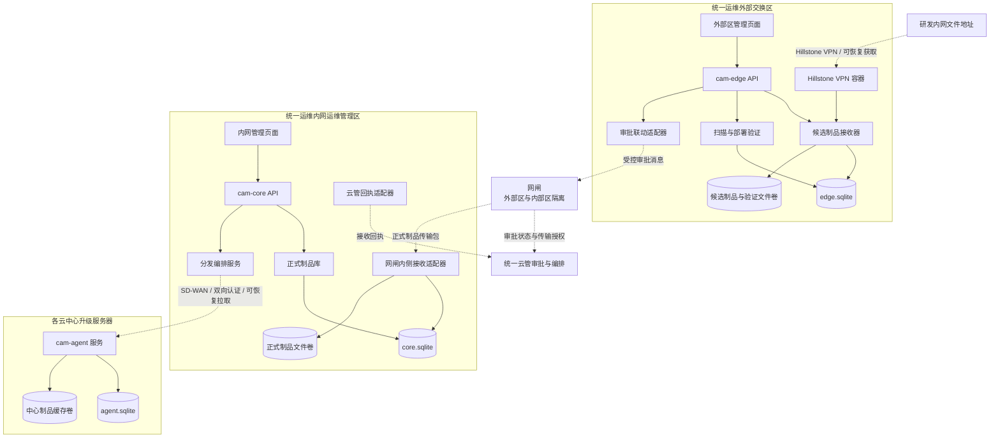
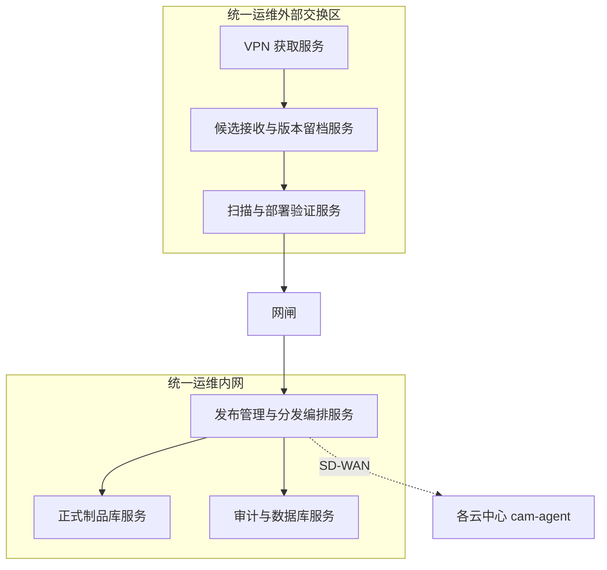
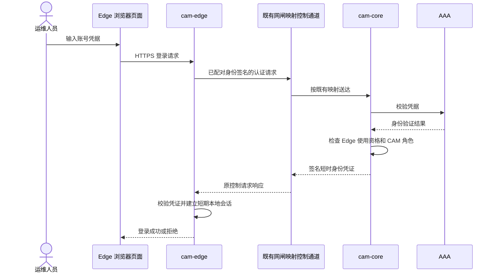
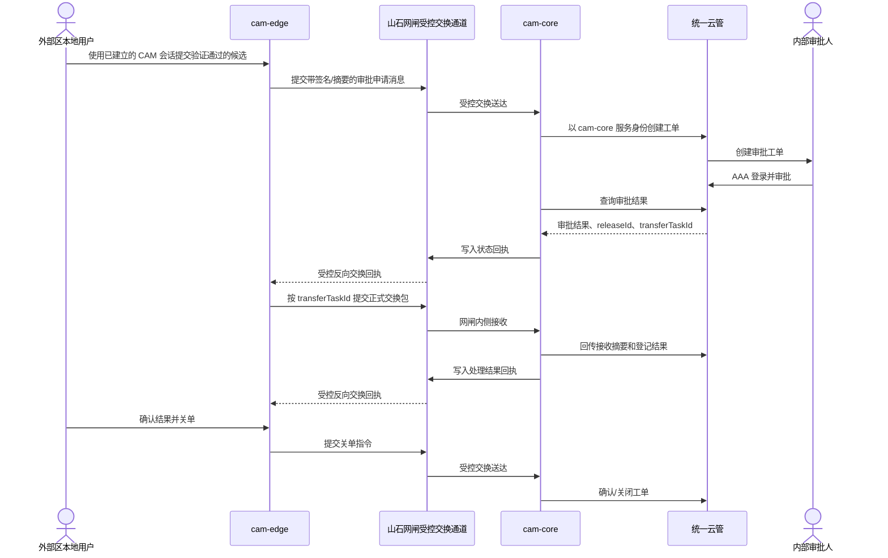

# 云平台软件制品管理系统技术方案

**工程名**：`cloud-artifact-management`  
**系统简称**：CAM（Cloud Artifact Management）  
**文档定位**：后续开发、部署、组件审计和运行维护的技术依据  
**对应架构文档**：`docs/system-design.md`  
**文档状态**：技术方案基线

## 1. 文档定位

本文档描述 CAM 的技术实现边界和工程约束。它与 `system-design.md` 分开维护：

- `system-design.md` 面向业务、总体架构和跨安全域流程，用于方案沟通和评审；
- `technical-solution.md` 面向开发、部署和运维，规定语言、框架、镜像、数据存储、传输和安全实现；
- 两份文档中的名称、区域边界和制品关系应保持一致。技术实现不得绕过架构文档定义的外部交换区、网闸、统一运维内网和云中心边界。

## 2. 技术决策

### 2.1 总体选型

CAM 采用 JavaScript 全栈实现，服务端、管理页面和共享库统一使用 ECMAScript Modules。首期不引入 Java、JVM、中间件集群或需要独立守护进程的基础设施。

| 层次 | 选型 | 约束 |
|---|---|---|
| 运行时 | Node.js 24 LTS | 锁定大版本和补丁版本；生产镜像不得运行时安装依赖 |
| 服务框架 | Fastify | 使用原生插件机制；路由、鉴权、审计和错误处理集中注册 |
| 模块系统 | ECMAScript Modules | `package.json` 设置 `type: module`；禁止混用未审计的 CommonJS 运行时包装层 |
| 管理页面 | AdminLTE 4 + Bootstrap 5 | 静态资源随镜像发布，不使用 CDN |
| 页面脚本 | 原生 JavaScript ES Modules | 不引入 Vue、React、Angular 或大型状��管理框架 |
| Excel 清单读取 | `read-excel-file@9.3.12` | 仅在 `cam-edge` 服务端解析 `.xlsx`；固定版本并审计全部传递依赖，限制上传大小和行数 |
| Excel 清单读取 | `read-excel-file` | 仅在 `cam-edge` 服务端解析 `.xlsx`；固定版本并审计全部传递依赖，限制上传大小和行数 |
| 数据库 | Node.js 内置 `node:sqlite` | 每个安全区使用独立 SQLite 文件，不共享数据库文件 |
| 制品文件 | 宿主机本地持久化目录 | 元数据和文件分离；正式制品不可覆盖 |
| 容器 | Docker Engine + Docker Compose | 使用内部镜像仓库；不首期引入 Kubernetes |

`node:sqlite`、Fastify、AdminLTE、Bootstrap、Node.js 基础镜像和所有 npm 依赖都必须纳入开源组件审计。若目标环境中的 Node.js 24 LTS 构建尚未通过审计，应暂停升级到未审计版本，不得用未经批准的外部数据库替代。

### 2.2 明确不引入的组件

首期不使用 MySQL、PostgreSQL、MongoDB、Redis、Kafka、RabbitMQ、ORM、服务网格、Kubernetes、外部对象存储和公有云 CDN。

这些组件不是永久禁止项；若后续规模导致 SQLite 或单机文件卷不能满足要求，必须先完成容量、可用性、安全审计和迁移设计，再单独变更技术基线。

### 2.3 设计目标

技术方案需要同时满足：

1. 外部交换区、统一运维内网和各云中心的数据隔离；
2. 大文件可恢复传输，网络中断不要求从零开始；
3. 文件摘要、清单签名、审批和传输回执可关联追溯；
4. 依赖可离线构建，生产环境不访问公网；
5. 单实例部署可通过优雅更新完成短时切换，后续可平滑拆分为多实例。

## 3. 技术架构



控制面只传递候选摘要、审批、授权、任务和状态；大文件在允许的传输链路上交换。外部交换区与内网不共享数据库、共享目录或任意文件上传接口。

## 4. 工程和服务划分

### 4.1 工程目录

```text
cloud-artifact-management/
├─ apps/
│  ├─ cam-edge/                 # 外部交换区服务
│  ├─ cam-core/                 # 统一运维内网服务
│  └─ cam-agent/                # 各云中心升级服务器服务
├─ libs/
│  ├─ cam-manifest/             # 清单、摘要和签名
│  ├─ cam-crypto/               # 密钥接口和密码操作封装
│  ├─ cam-transfer/             # 分块、续传、重试和合并
│  ├─ cam-sqlite/               # SQLite 连接、迁移和事务封装
│  └─ cam-protocol/             # 区内 API 和跨区消息结构
├─ edge-web/                    # cam-edge-web 页面工程
│  ├─ index.html                # 外部交换区管理页面入口
│  ├─ app.js                    # 页面交互和候选任务操作
│  └─ app.css                   # 页面定制样式
├─ core-web/                    # cam-core-web 页面工程
│  ├─ index.html                # 统一运维内网管理页面入口
│  ├─ core.js                   # 页面交互和云管审批操作
│  └─ core.css                  # 页面定制样式
├─ agent-web/                   # cam-agent-web 静态页面和反向代理工程
│  ├─ index.html                # Agent 静态页面入口
│  ├─ build.mjs                 # 构建时复制页面和共享资源
│  └─ Caddyfile                 # 静态文件服务及 Agent API 反向代理
├─ edge-web.Dockerfile          # Edge 管理页面静态资源和反向代理镜像
├─ core-web.Dockerfile          # Core 管理页面静态资源和反向代理镜像
├─ agent-web.Dockerfile         # Agent 静态页面和反向代理镜像
├─ deploy/
│  ├─ docker/                   # Dockerfile、启动脚本和健康检查
│  ├─ compose/                  # edge、core、agent 部署文件
│  └─ offline/                  # 离线构建物料清单和校验文件
├─ migrations/                  # 按安全区分组的 SQLite 迁移
├─ package.json
├─ package-lock.json
└─ README.md
```

共享库只放无安全区状态的纯函数或协议实现。数据库连接、文件路径、密钥和运行配置不得放入共享库的全局变量。

### 4.2 镜像和服务职责

| 镜像 | 部署区域 | 服务职责 | 不负责的事项 |
|---|---|---|---|
| `cam-edge-web` | 统一运维外部交换区 | AdminLTE 管理页面、静态资源和 `/api/*` 反向代理到 `cam-edge` | 业务数据持久化、跨区传输和审批决策 |
| `cam-edge` | 统一运维外部交换区 | 研发候选制品获取、候选版本留档、扫描验证、发布申请、审批结果接收、网闸发送包准备 | 正式制品库、内网分发、云中心升级 |
| `cam-core-web` | 统一运维内网 | AdminLTE 管理页面、静态资源、Agent 页面入口和 `/api/*` 反向代理 | 审批业务、正式制品处理和云管适配 |
| `cam-core` | 统一运维内网 | 网闸接收、正式制品登记、版本管理、分发编排、权限、审计和云管回执 | 研发地址访问、外部候选验证 |
| `cam-agent-web` | 每个云中心升级服务器 | Agent 静态页面、Caddy、TLS/反向代理；仅将 `/api/*`、`/health/*` 转发给 `cam-agent` | 业务数据、认证决策和任务调度 |
| `cam-agent` | 每个云中心升级服务器 | 任务拉取、分块下载、缓存、校验、向控制节点提供正式文件和结果回报 | 修改正式制品、跨中心调度、替代现有升级程序 |

`cam-agent` 是中心升级服务器上的制品接收与缓存服务。控制节点仍使用已有升级脚本或升级程序读取校验通过的缓存文件，不新增一个独立的“控制节点升级执行器”平台。

## 5. 部署方案

### 5.0 Hillstone 宿主机前置条件

统一运维外部交换区使用的 Hillstone 镜像依赖 Linux 内核的 legacy netfilter 表。正式环境部署前必须确认宿主机可以加载以下模块：

```text
ip_tables
iptable_filter
iptable_nat
iptable_mangle
```

部署包中的 `deploy/install-hillstone-route.sh` 会安装 `deploy/cam-hillstone-netfilter.conf` 到 `/etc/modules-load.d/`，立即执行 `modprobe` 加载模块，并启用动态路由服务。正式环境禁止只使用 nftables 映射替代这些模块，因为容器可能显示 healthy，但 Hillstone 客户端的 TUN 隧道仍不会进入在线状态。

部署前检查：

```bash
uname -r
test -c /dev/net/tun
modprobe ip_tables
modprobe iptable_filter
modprobe iptable_nat
modprobe iptable_mangle
iptables-legacy -S
```

安装后验证：

```bash
systemctl is-enabled cam-hillstone-route.service
systemctl is-active cam-hillstone-route.service
docker compose --env-file .env ps hillstone-vpn
docker exec cam-hillstone-vpn iptables -S
docker exec cam-hillstone-vpn ip link show tun0
```

其中容器状态 healthy 只表示基础进程、NAT 和管理端口满足健康检查；是否真正在线必须以 Hillstone 管理界面的 VPN 状态和 `tun0` 状态为准。若 `tun0` 仍为 `DOWN`，先通过 noVNC 完成 VPN 登录，再检查研发地址连通性。

### 5.1 小规模合并部署

环境规模不大时，首期按安全区部署虚拟机：

| 部署位置 | 数量 | 首期规格 | 主要数据 |
|---|---:|---|---|
| 统一运维外部交换区 | 1 台虚拟机 | 16 vCPU、32 GB 内存、2 TB 可用虚拟存储 | 候选制品、扫描副本、验证证据和 `edge.sqlite` |
| 统一运维内网运维管理区 | 1 台虚拟机 | 16 vCPU、32 GB 内存、2 TB 可用虚拟存储 | 正式制品、发布记录、分发任务和 `core.sqlite` |
| 每个云中心或独立安全域 | 1 台虚拟机 | 16 vCPU、32 GB 内存、2 TB 可用虚拟存储 | 中心缓存、传输临时文件、回滚版本和 `agent.sqlite` |

上述 2 TB 是首期可用虚拟存储基线。13 GB、19 GB 级别制品需要为临时分块、完整文件、扫描副本和历史版本预留空间，容量计算以最大制品大小、并发任务和保留策略为准。虚拟化平台负责底层存储可靠性、备份和扩容，本文不限定物理磁盘组织方式。

研发内网文件服务器、网闸、统一云管和云平台控制节点使用已有环境，不计入 CAM 新增虚拟机数量。政务外网、互联网等相互隔离的安全域必须分别部署 `cam-agent`，不能跨安全域共用同一接收服务器。

每台虚拟机使用该安全区专属的 Docker Engine、Compose 文件、网络和宿主机本地数据目录。外部区和内网不共享业务数据目录；云中心只挂载本中心缓存目录。

外部交换区的 `cam-edge` 与 Hillstone VPN 容器共享网络命名空间。Hillstone 容器负责 TUN 设备、VPN 会话和研发网段路由；`cam-edge` 不直接持有 VPN 凭据，也不直接访问外部代理端口。Hillstone 配置和运行数据使用独立持久化卷，管理端口只绑定目标虚拟机本地地址。

在 Ubuntu 新内核环境中，Hillstone 仍使用镜像原生的 `iptables-legacy` 入口。部署前由 `deploy/cam-hillstone-netfilter.conf` 配置宿主机开机加载 `ip_tables`、`iptable_filter`、`iptable_nat` 和 `iptable_mangle` 模块，容器不替换 `iptables` 后端。这样保留 Hillstone 客户端依赖的 legacy 网络行为，避免仅满足容器健康检查而导致客户端隧道不在线。

宿主机到研发地址的路由由 `deploy/cam-hillstone-route.service` 管理。路由脚本等待 Compose 网络和容器出现，使用网络 ID 的前 12 位动态定位 Docker 网桥，再查询 Hillstone 容器在该网络中的 IP，最后执行 `ip route replace <目标> via <Hillstone IP> dev <Docker 网桥>`。网络重建或容器重建后由 `start`、`restart` 流程重新执行服务；网桥名和容器 IP 不写入固定配置。默认目标为研发文件服务器 `172.22.5.177/32` 和 `172.22.5.66/32`，避免与测试机其他 Docker 网络的 `172.22.0.0/16` 地址空间产生全网段路由覆盖。

CAM Compose 默认使用 `192.168.240.0/24` 作为专用 Docker 网络，避开测试机常见的 `172.20.0.0/16`、`172.21.0.0/16` 和 `172.22.0.0/16` 网段。部署时应通过 `CAM_DOCKER_SUBNET` 选择未被主机、VPN、云平台或其他 Docker 网络使用的地址段；不得把研发网段配置为 Docker 网络地址段。

直连部署还需检查宿主机上其他 Docker 网络是否占用了研发文件服务器所在网段。如果存在整段 Docker 路由覆盖研发地址，应执行 `deploy/install-cam-source-route.sh` 安装 `cam-source-route.service`。该服务直接读取项目 `.env` 的 `CAM_SOURCE_ALLOWLIST`，为每个主机名解析出的 IPv4 地址安装精确 `/32` 路由，动态使用宿主机默认网关和网卡，从而避开冲突 Docker 网桥。allowlist 变化后重新执行安装脚本或重启服务即可同步路由。

### 5.2 后续拆分部署

当候选接收、验证、正式制品保留量或云中心数量增长时，可按职责拆分：



拆分时仍保持同一安全区内的最小必要访问：VPN 获取服务只访问研发地址，验证服务只读候选卷，发布管理只接收验证结论，正式制品库只接受审批关联的网闸接收包。SQLite 文件不能在多个虚拟机之间共享。

## 6. 容器和运行约束

### 6.1 Docker 镜像

- 使用内部审计通过的 Node.js 24 LTS 基础镜像；
- 通过 `npm ci --omit=dev` 生成生产依赖，构建后不在生产容器执行 `npm install`；
- 镜像使用不可变 tag 和 SHA-256 digest，发布清单记录镜像 digest；
- 镜像只从内部镜像仓库拉取，构建环境通过离线 npm 缓存和内部制品源提供依赖；
- 镜像中不放置生产密钥、数据库文件或大制品；
- 前端 AdminLTE、Bootstrap 和图标资源打包进镜像，不从 CDN 加载。

### 6.2 容器安全

生产 Compose 配置必须满足：

- 使用非 root 用户运行；
- 根文件系统设置为只读；
- `/tmp` 等临时目录使用 `tmpfs`；
- 不使用 `privileged`，不挂载 Docker Socket；
- 仅挂载必要的只读配置和专属宿主机数据目录；
- 限制 CPU、内存、打开文件数和临时空间；
- 仅开放本安全区必需端口，跨区流量经网闸或受控 SD-WAN；
- 日志输出到标准输出并由现有日志系统采集，同时保存关键审计记录；
- 容器启动时执行数据库迁移前置检查，迁移失败不得启动业务流量。

### 6.3 更新和可用性

更新流程为“内部仓库推送新镜像、校验 digest、备份配置和数据库、拉取新镜像、健康检查、优雅停止旧容器、启动新容器”。服务收到停止信号后停止接收新任务，等待正在写入的分块完成或标记为可恢复状态。

首期单实例更新允许出现很短的管理页面切换窗口；未完成的传输任务不得因容器切换而丢失。若要求管理面严格无中断，再将同一镜像扩展为双实例或蓝绿 Compose 部署，SQLite 仍按安全区单主写入约束运行。

生产部署中的 `edge`、`core` 和 `agent` 业务数据必须使用宿主机固定目录绑定挂载，例如
`/var/lib/cloud-artifact-management/edge`、`core` 和 `agent`。部署前由
`deploy/init-data-directories.sh` 创建目录并设置容器用户 `10001:10001` 的权限，Compose
只负责挂载目录，不创建或管理业务数据卷。SQLite 文件、WAL/SHM 文件、分块进度和制品文件
都直接落在对应本地目录中；项目目录或 Compose 项目名变化不会切换数据位置。

Hillstone 的配置和运行状态仍使用独立的 Docker 管理卷，因为它们属于 VPN 客户端运行环境，
不属于 CAM 业务数据库。所有业务目录和 Hillstone 状态都必须纳入宿主机备份，备份 SQLite
时应停止对应写入并整体复制目录，不能只复制 `.sqlite` 主文件。

## 7. 数据和文件存储

### 7.1 SQLite 组织

每个安全区独立维护 SQLite 数据库：

| 数据库 | 所在区域 | 典型记录 |
|---|---|---|
| `edge.sqlite` | 外部交换区 | 候选制品、来源快照、验证记录、扫描结果、候选传输进度 |
| `core.sqlite` | 统一运维内网 | 正式发布、制品索引、审批引用、网闸接收、分发任务、审计事件 |
| `agent.sqlite` | 单个云中心升级服务器 | 中心任务、分块进度、缓存校验、控制节点取用和结果回报 |

SQLite 使用 WAL、外键约束、参数化 SQL 和事务。数据库文件放在本地宿主机目录，不能放在
NFS、跨主机共享目录或网闸共享目录。大文件绝不写入 SQLite BLOB；数据库仅保存路径、大小、
摘要、状态和审计元数据。

备份采用 SQLite 在线备份或短事务复制，并把备份文件写入本安全区的受控备份位置。恢复后必须校验数据库完整性、文件摘要和发布记录关联。

### 7.2 逻辑数据表

表名按安全区分布，字段可以按实现需要扩展，但以下主键和关联必须保留：

| 表 | 关键字段 | 用途 |
|---|---|---|
| `candidates` | `candidate_id`、来源地址、原始文件名、大小、SHA-256、版本、接收时间 | 外部区候选快照；同一来源文件更新必须产生新候选 ID |
| `verification_records` | `verification_id`、`candidate_id`、验证类型、结果、证据路径、操作者、时间 | 记录扫描、完整性、兼容性和部署验证 |
| `releases` | `release_id`、`candidate_id`、`artifact_id`、版本、目标范围、清单摘要、状态 | 统一运维确认的正式发布基线 |
| `artifacts` | `artifact_id`、文件名、文件路径、大小、完整 SHA-256、签名引用 | 制品不可覆盖的文件索引 |
| `approvals` | `approval_id`、`release_id`、审批系统单号、结论、有效期、审批人 | 统一云管审批引用 |
| `transfer_tasks` | `transfer_task_id`、来源区、目标区、关联 ID、模式、状态、重试次数 | 网闸或 SD-WAN 传输任务 |
| `transfer_parts` | 任务 ID、分块序号、偏移、大小、摘要、接收状态、重试次数 | 分块断点续传进度 |
| `distribution_tasks` | 任务 ID、`release_id`、中心、目标 Agent、维护窗口、结果 | 内网到云中心的分发编排 |
| `audit_events` | 事件 ID、操作者、动作、对象、前后摘要、时间、来源 | 不可抵赖的操作审计 |

ID 使用带有区域和时间语义的不可预测字符串或 UUID。文件名不是主键，版本号不是唯一键；正式文件对象以完整 SHA-256 为内容身份，发布基线中的包条目是指向该对象的不可变逻辑引用。

### 7.3 文件目录约束

```text
/data/
├─ db/
│  └─ <zone>.sqlite
├─ candidates/
│  ├─ <candidateId>/parts/                  # 接收中的临时分片
│  └─ objects/sha256/<前2位>/<再2位>/<完整SHA-256>  # Edge 候选内容对象
├─ verification/
│  └─ <candidateId>/
├─ releases/
│  └─ <releaseId>/                 # 发布/基线元数据，不存放对象副本
├─ artifacts/
│  └─ sha256/<前2位>/<再2位>/<完整SHA-256>  # 内容寻址的正式文件对象
├─ transfers/
│  └─ <transferTaskId>/parts/
└─ tmp/
```

临时目录不能作为正式制品引用。正式文件先写入临时路径并完成大小与 SHA-256 校验，再原子改名到内容寻址路径。`core_artifacts` 保存对象摘要、大小和路径；`core_release_artifacts` 将每个获批发布基线、包标识、文件名和来源关系关联到对象摘要。数据库保存关系，文件系统保存字节。

对象路径由 SHA-256 派生，文件名、软件版本、候选轮次和 `packageKey` 均不参与物理对象身份判断。同一 ISO 在多个软件版本、修订版或不同包条目中复用时，只保留一份字节对象，每个不可变清单仍保留自己的文件名、包键、目标、候选来源和继承来源。只有实际 SHA-256 相同才能复用；同名但摘要不同的文件始终是两个对象。Edge 的候选文件完成完整校验后统一写入本地 SHA-256 内容对象目录，候选记录只通过数据库字段引用对象；Edge 的轮次继承继续复用候选映射，Core 的内容寻址去重负责跨版本和跨发布基线复用。

对象不因单个版本被替代或一条基线被隐藏而立即删除。首期不做自动垃圾回收；后续清理必须在事务中确认没有正式基线、传输任务、分发任务或审计记录引用对象，并先写审计事件。备份必须成套覆盖 `core.sqlite`、正式对象目录和必要的暂存任务状态；恢复后核对数据库对象索引与文件摘要。

## 8. 清单、签名和制品包

### 8.1 原始制品和传输包关系

`manifest.json` 是原始制品的结构化说明和校验凭据，不是另一个软件包。`transfer-bundle` 是一次传输任务的封装目录，里面可以包含原始制品、清单、签名、验证证据摘要和传输申请。原始文件名保持研发提供的名称。

```text
transfer-bundle/
├─ payload/
│  └─ <研发提供的原始文件名>
├─ parts/                         # 仅在分块交换模式下存在
│  ├─ part-000000
│  └─ part-000001
├─ manifest.json
├─ manifest.sig
├─ verification-summary.json
└─ transfer-request.json
```

### 8.2 清单字段

```json
{
  "schemaVersion": 1,
  "artifactId": "ART-20260929-0001",
  "releaseId": "REL-20260929-0001",
  "fileName": "cloud-base-8.0.6.2-amd64.tar.gz",
  "size": 20401094656,
  "sha256": "<完整原始文件 SHA-256>",
  "version": "8.0.6.2",
  "architecture": "amd64",
  "targets": ["政务外网", "互联网"],
  "approvalId": "APR-20260929-0001",
  "transferTaskId": "TR-20260929-0001",
  "transfer": {
    "mode": "chunked",
    "chunkSize": 268435456,
    "chunkCount": 76,
    "chunks": [
      {"index": 0, "offset": 0, "size": 268435456, "sha256": "<分块摘要>"}
    ]
  }
}
```

实际实现中可把完整 `chunks` 数组写入清单或旁车清单文件，但其摘要必须纳入 `manifest.sig` 签名。签名覆盖规范化后的清单内容，接收端先验签，再校验文件和分块。

## 9. 三段传输和断点续传

### 9.1 通用规则

断点续传采用“协议能力优先，应用层分块兜底”的模式：

1. 传输开始时固定 `artifactId`、文件大小、完整 SHA-256、分块大小和分块数量；
2. 接收端持久化每个分块的摘要和状态，接收端记录是恢复依据；
3. 重复收到相同分块时先校验摘要，已存在且一致则幂等跳过；
4. 分块全部完成后合并或验证完整文件，再计算完整 SHA-256；
5. 完整摘要、清单签名和授权关联全部通过后，临时文件才原子切换为可用制品；
6. 任务可暂停、继续、重试和过期清理，清理不得删除仍被正式发布引用的文件。

首期默认分块大小为 256 MiB，允许按网闸和链路能力配置为 512 MiB。分块大小一旦进入传输任务和清单，不得在任务中途改变。

### 9.2 研发内网地址到外部交换区

候选接收器通过统一运维外部交换区的 Hillstone VPN 容器访问研发内网文件地址。若来源支持 HTTP Range，使用 `Range` 和稳定的 `ETag` 或来源摘要请求缺失区间；若来源支持 SFTP，使用远端文件大小、偏移读取和本地分块进度恢复。

下载前后都要确认来源对象的大小和版本标识。若研发侧更新同名文件，导致 `ETag`、大小或摘要变化，旧临时文件不能继续拼接，系统必须生成新的 `candidateId` 并从新对象重新开始。

### 9.3 外部交换区到统一运维内网

优先使用网闸自身的可恢复交换任务。如果网闸只能按完整文件交换，`cam-edge` 按清单生成 `parts/` 分块文件，网闸只传输缺失或校验失败的分块。内网接收适配器在 `transfer_parts` 中保存接收进度。

网闸传输完成后，`cam-core`：

1. 校验 `transfer-request.json` 中的 `approvalId`、`releaseId`、`artifactId` 和目标安全域；
2. 验证 `manifest.sig`，确认清单未被修改；
3. 逐块校验摘要，并将实际计算的 SHA-256 与 Edge 请求头中签名保护的分块摘要比对，拒绝序号、偏移、大小或摘要不匹配的分块；
4. 最后一块持久化后立即返回“分块已接收、文件待校验”，不让上传请求同步等待大文件组装；Edge 保持心跳并等待该文件的校验结果；
5. Core 在后台按序合并为清单中指定的原始文件名，并校验合并文件大小和完整 SHA-256；校验失败时保留文件级错误，不允许 Edge 继续下一个文件；
6. 将校验通过的文件原子放入 SHA-256 内容寻址库；同摘要对象已存在时先校验现存文件后复用；
7. 建立发布基线到文件对象的逻辑引用，确认批准清单中的全部文件均可从正式库读取后才回传接收回执。

对象上传接口必须绑定已核准的 `transferTaskId`，且文件 SHA-256 必须在云管批准的清单内。重试同一对象应幂等；同摘要但大小不匹配、传输任务与清单不匹配或文件校验失败时拒绝登记。边界传输按块续传可以复用现有 `transfer_parts` 模式；对象完成前只落在任务临时目录，完成后同文件系统原子改名。

网闸本身是否支持续传不改变 CAM 的最终完整性判断。网闸重试只改变传输状态，不改变 `artifactId` 或正式制品内容。

### 9.4 统一运维内网到各云中心

由 `cam-agent` 通过 SD-WAN 主动拉取已授权的制品。推荐使用带 Range 的分块下载接口；无法提供 Range 时使用清单中的分块接口。`cam-agent` 将分块进度写入本中心 `agent.sqlite`，下载中断、服务重启或维护后从缺失分块继续。

完整制品写入缓存临时目录，完成签名、分块和完整 SHA-256 校验后原子改名。控制节点只读取 `READY` 状态的文件。分发任务包含限速、维护窗口、失败重试、重试上限和过期时间，避免占用云平台生产运维流量。

### 9.5 传输状态和失败处理

传输状态至少包括 `PENDING`、`RUNNING`、`PAUSED`、`RETRYING`、`COMPLETED`、`FAILED` 和 `EXPIRED`。状态更新必须带任务 ID、尝试次数、已完成分块数、最近错误和时间。

以下情况必须使任务失败并保留证据：

- 文件大小、来源标识或摘要发生变化；
- 分块摘要不匹配；
- 清单签名无效或审批已撤销；
- 目标安全域与授权不一致；
- 重试超过策略上限；
- 完整文件摘要与清单不一致。

失败任务不能通过修改清单或手工改数据库恢复。应依据原发布重新生成新的传输尝试，或在同一任务中清理错误分块后重新获取，并保留每次尝试的审计记录。

## 10. 区内接口和跨区联动

### 10.1 区内管理 API

`cam-edge`、`cam-core` 和 `cam-agent` 各自提供最小化 HTTPS API。接口采用 JSON、版本化路径和统一错误结构；大文件不放在普通 JSON 请求中。

代表性接口如下：

| 服务 | 接口 | 作用 |
|---|---|---|
| `cam-edge` | `POST /api/v1/candidates` | 创建候选接收任务 |
| `cam-edge` | `POST /api/v1/products` | 创建软件产品 |
| `cam-edge` | `DELETE /api/v1/products/:productId` | 删除没有发布版本的空软件产品 |
| `cam-edge` | `POST /api/v1/products/:productId/releases` | 创建产品发布版本 |
| `cam-edge` | `DELETE /api/v1/releases/:releaseId` | 删除没有候选包的开放发布版本 |
| `cam-edge` | `POST /api/v1/releases/:releaseId/rounds` | 创建候选收集轮次，可继承基线轮次 |
| `cam-edge` | `GET /api/v1/rounds?productId=&releaseId=` | 按软件产品或发布版本一次查询候选轮次，供列表筛选使用 |
| `cam-edge` | `GET /api/v1/rounds/:roundId/candidates` | 查询轮次候选包清单及继承来源 |
| `cam-edge` | `POST /api/v1/rounds/:roundId/candidates` | 在轮次中新增或替换候选包 |
| `cam-edge` | `POST /api/v1/rounds/:roundId/import-preview` | 解析 Excel 并返回列映射、逐行校验和候选预览，不创建任务 |
| `cam-edge` | `POST /api/v1/rounds/:roundId/import` | 将用户确认的候选行创建到指定轮次；重复包标识不覆盖已有映射 |
| `cam-edge` | `POST /api/v1/rounds/:roundId/import-preview` | 解析 Excel 并返回列映射、逐行校验和候选预览，不创建任务 |
| `cam-edge` | `POST /api/v1/rounds/:roundId/import` | 将用户确认的候选行创建到指定轮次；重复包标识不覆盖已有映射 |
| `cam-edge` | `GET /api/v1/candidates/:id` | 查询候选元数据、状态和摘要 |
| `cam-edge` | `GET /api/v1/candidates?productId=&releaseId=` | 按软件产品或发布版本查询候选包列表，避免前端按版本逐个请求 |
| `cam-edge` | `GET /api/v1/candidates/:id/parts` | 查询候选分块进度 |
| `cam-edge` | `PUT /api/v1/candidates/:id/parts/:partIndex` | 接收一个带 SHA-256 校验的候选分块 |
| `cam-edge` | `POST /api/v1/candidates/:id/receive` | 按研发地址和 HTTP Range 异步接收候选文件 |
| `cam-edge` | `POST /api/v1/candidates/:id/complete` | 合并分块、校验完整摘要并固化候选文件 |
| `cam-edge` | `POST /api/v1/download-grants` | 为已完成候选包创建浏览器或测试服务器下载授权，并导出授权清单 |
| `cam-edge` | `GET /api/v1/download-grants/:grantId` | 查询下载授权、有效期、剩余次数和下载汇总 |
| `cam-edge` | `DELETE /api/v1/download-grants/:grantId` | 撤销下载授权并阻止后续下载 |
| `cam-edge` | `POST /api/v1/downloads/:candidateId/session` | 用授权 Token 建立或恢复一个下载会话 |
| `cam-edge` | `GET /api/v1/downloads/:candidateId/content` | 在授权范围内下载候选文件，支持 HTTP Range |
| `cam-edge` | `GET /api/v1/download-grants/:grantId/manifest` | 导出测试服务器批量下载所需的 JSON 清单 |
| `cam-edge` | `POST /api/v1/releases/:id/submit-approval` | 提交验证通过的正式发布申请 |
| `cam-core` | `POST /api/v1/gate/receipts` | 登记网闸接收回执 |
| `cam-core` | `POST /api/v1/gate/approval-requests` | 接收外部区固化申请并创建云管工单 |
| `cam-core` | `GET /api/v1/approval-requests/:requestId` | 查询审批联动状态 |
| `cam-core` | `GET /api/v1/artifacts` | 查询已接收的正式版本及其文件清单；按软件和版本归档，不暴露 Edge 固化轮次 |
| `cam-core` | `GET /api/v1/artifacts/:artifactId` | 查询单个正式版本基线，供后续 `cam-agent` 分发任务引用 |
| `cam-core` | `GET /api/v1/artifacts/:sha256/content` | 按已授权文件摘要下载正式制品字节 |
| `cam-core` | `POST /api/v1/approval-requests/:requestId/sync` | 由内网适配器向云管查询并更新审批状态 |
| `cam-core` | `POST /api/v1/approval-requests/:requestId/withdraw` | 在云管审批完成前撤回 Core 本地申请；不调用云管撤回接口 |
| `cam-core` | `POST /api/v1/approval-requests/:requestId/transfer-authorize` | 核验云管批准结果并生成内网传输任务 |
| `cam-core` | `GET /api/v1/gate/transfers/:transferTaskId/manifest` | 在网闸身份校验下返回已批准文件清单及对象是否已存在 |
| `cam-core` | `PUT /api/v1/gate/transfers/:transferTaskId/artifacts/:sha256` | 接收单个获批文件，按摘要校验并写入内容寻址正式库 |
| `cam-core` | `POST /api/v1/gate/receipts` | 验证网闸送达的传输任务和清单摘要并登记接收回执 |
| `cam-core` | `POST /api/v1/approval-requests/:requestId/close` | 向云管确认关单并记录结果 |
| `cam-core` | `POST /api/v1/agents` | 管理员登记 Agent 身份公钥并完成配对；Core 不下发固定服务令牌 |
| `cam-core` | `GET /api/v1/distribution-agents` | 返回分发页面所需的 Agent 基本信息；业务操作员可读，不暴露身份轮换详情 |
| `cam-core` | `POST /api/v1/distribution-tasks` | 管理员为一个 Agent 指定已入库正式版本并建立队列任务 |
| `cam-core` | `POST /api/v1/agent/tasks/pull` | Agent 主动轮询，仅返回目标 Agent 的到期任务 |
| `cam-core` | `GET /api/v1/agent/tasks/:id/manifest` | 返回绑定目标 Agent 的任务清单快照 |
| `cam-core` | `GET /api/v1/agent/tasks/:id/files/:sha256/parts/:index` | 通过并行分块拉取已授权文件 |
| `cam-core` | `POST /api/v1/agent/tasks/:id/progress` | 接收任务进度、完成校验或失败回执；返回 Core 对任务的控制状态 |
| `cam-core` | `GET /api/v1/transfer-monitor` | 查看 Edge → Core 和 Core → Agent 两类传输任务及汇总进度 |
| `cam-core` | `POST /api/v1/distribution-tasks/:taskId/start`、`/retry` | 在 Core 侧立即开始或重试指定 Agent 分发任务 |
| `cam-core` | `POST /api/v1/distribution-tasks/:taskId/control` | 在 Core 侧暂停、继续或取消指定 Agent 分发任务 |
| `cam-agent` | `POST /api/v1/auth/login` | 本地管理员密码登录；设备签名身份与人员会话隔离 |
| `cam-agent` | `GET /api/v1/identity` | 登录后读取本机公钥、指纹和从 Core 回显并持久保存的 Agent 编号 |
| `cam-agent` | `POST /api/v1/identity/test` | 使用本机签名验证 Core 配对，需要本地登录和 CSRF 校验 |
| `cam-agent` | `POST /api/v1/identity/rotate` | 使用旧身份向 Core 提交新公钥，并在本地原子保存新身份 |
| `cam-agent` | `GET /api/v1/tasks` | 查看本地持久化队列及进度 |
| `cam-agent` | `GET /api/v1/available-artifacts` | 查询 Core 全量正式版本及版本级/文件级本地缓存状态 |
| `cam-agent` | `GET /api/v1/cache/summary` | 查询缓存对象、文件、容量、可用空间和异常对象摘要 |
| `cam-agent` | `GET /api/v1/tasks/:taskId` | 查询任务详情、逐文件进度、分块进度和 SHA-256 复用状态 |
| `cam-agent` | `POST /api/v1/tasks/:taskId/retry` | 请求 Core 立即重试归属本 Agent 的失败任务 |
| `cam-agent` | `GET /api/v1/cache/:artifactId` | 查询本中心是否有 READY 制品 |
| `cam-agent` | `GET /api/v1/delivery-grants`、`POST /api/v1/delivery-grants` | 查询或创建面向人工部署人员的正式制品交付授权 |
| `cam-agent` | `GET /api/v1/delivery-grants/:grantId`、`DELETE /api/v1/delivery-grants/:grantId` | 查看交付授权及下载会话明细，或撤销授权 |
| `cam-agent` | `GET /api/v1/delivery-grants/:grantId/manifest` | 使用一次性短期 Token 获取交付清单和文件链接 |
| `cam-agent` | `POST /api/v1/delivery-grants/:grantId/files/:sha256/session`、`GET /api/v1/delivery-grants/:grantId/files/:sha256/content` | 建立/恢复下载会话并从 Agent 本地缓存按 Range 下载文件 |

### cam-agent 首期分发详细设计

身份持久化约束（覆盖本节早期兼容描述）：本项目不保留历史部署兼容逻辑。Agent 的 Core 地址、公钥、过渡公钥和配对状态只存入 Agent 本地 `agent.sqlite`；Agent 私钥只存入主机绑定数据目录的 `identity.json`（`0600`）。Core 私钥只存入 Core 主机绑定数据目录的 `core-agent-identity.json`（`0600`）。不得通过 `.env`、Compose 外部变量、镜像或数据库传递任何私钥或 Core 身份公钥；Compose 只负责挂载持久化数据目录。

采用 Core 编排、Agent 主动拉取的模式。Core 管理员登记中心标识、Agent 名称和公钥完成身份配对，不再设置单独的安全域字段；Core 不下发固定服务令牌。各隔离网络仍独立部署 Agent，授权以中心、Agent 身份和分发任务为准。停用 Agent 会立即拒绝轮询、清单、进度和文件请求。Core 管理员按 Agent 单独创建分发任务，任务绑定正式 `artifactId`、清单摘要和文件摘要快照，Agent 不能自行选择其他中心或正式版本。

Core 与 Agent 使用双向应用层签名。每台 Agent 保留独立 Ed25519 私钥，Core 登记 Agent 公钥；Agent 请求签名覆盖规范化的 HTTP 方法、路径、时间戳、随机数和原始请求体 SHA-256。Core 另生成持久化服务身份 `core-agent-identity.json`，只在 Core 保存私钥，并把服务公钥配置到所有 Agent。Core 返回 Agent API 响应时签名覆盖 HTTP 状态、方法、路径、请求 nonce、响应时间戳和原始响应体 SHA-256，Agent 验证签名后才解析响应或写入任务状态，业务错误和文件分块响应同样适用。Core 服务身份轮换使用分阶段签名协商：Core 暂存新身份并继续使用旧身份签署响应，Agent 验证提案后保存新公钥并提交签名确认；Core 在所有未禁用 Agent 确认后提前启用新身份，最多等待配置的旧身份过渡期；超时后仍启用新身份，并跳过未确认的离线 Agent。在线 Agent 在截止时间前的下次主动请求时完成更新；超时后重新上线的 Agent 需管理员重新配对。

Agent 人员登录直接调用 AAA；Agent 只保存本地 CAM 角色映射和会话摘要，不保存 AAA 密码。Agent 使用 `agent.sqlite` 保存设备本地应急管理员、授权映射和会话，初始管理员通过仅限终端的初始化命令创建。密码至少 12 个字符、使用 scrypt 派生，登录失败限制和 CSRF 会话校验沿用 Core/Edge 的现有机制。人员密码绝不作为 Core 的服务认证凭据。Agent 首次启动在本地数据目录生成 Ed25519 身份密钥，管理员把公钥提交到 Core 完成配对；Agent 后续请求使用 Agent ID、时间戳、随机数和请求签名认证，Core 保存公钥指纹并拒绝重放。Core 为每个 Agent 保存自动轮换周期（默认 90 天）和旧、新身份过渡期（默认 24 小时），并可排队要求立即轮换。Agent 仅通过出站轮询取策略和请求，离线时 Core 保留请求。Agent 先以原子写入在本机持久化待用私钥，再使用当前身份提交新公钥，并用待用私钥对相同签名信封提供持有证明；Core 仅接受当前身份发起换钥，防止仍在宽限期内的旧身份覆盖新身份。重复提交相同公钥幂等且不会延长过渡期。Agent 使用新身份探测 Core 已切换后再替换当前身份，并明确确认；私钥始终留在 Agent。响应丢失和重启均复用持久化待用密钥，网络失败采用 5 秒起、最长 5 分钟的指数退避。Core 与 Agent 页面显示确认、下次轮换、失败原因和重试时间。Core 服务身份文件由 Core 生成并持久化在 Core 数据目录；Agent 只在本机 `agent.sqlite` 保存 Core 地址、公钥、过渡公钥和配对结果。身份信息不得通过 `.env`、Compose 外部变量、镜像或数据库传递；Compose 只负责挂载持久化数据目录，页面保存的配置由本地 SQLite 作为唯一运行时来源。

Core 任务状态为 `SCHEDULED → QUEUED → RUNNING → COMPLETED`；传输失败会记录错误、重试次数和下次重试时间，并使用从 5 秒起、最多 5 分钟的指数退避。Core 监测页面按 Edge → Core、Core → Agent 分成两张表：Edge → Core 的人工重试统一由 Core 发起；Core → Agent 以单个 Agent 分发任务为控制粒度，支持暂停、继续和取消。运行中的任务收到暂停/取消请求后，在 Agent 完成当前分块并上报进度时生效，页面显示“等待暂停/等待取消”；排队任务可立即进入“已暂停/已取消”。文件级只展示逐文件、分块和错误进度，不提供单文件控制。Agent 每轮只领取归属自己的任务，单个 Agent 同一时刻串行处理一个任务；同一 Agent 在同一时间段到期的任务按创建时间依次排队，不会把多个任务的分块线程数叠加。不同 Agent 使用各自的队列，可以并行传输。任务执行和分块进度落入本地 SQLite；服务重启后继续使用缓存临时分块。每个完整文件先落入临时文件，整文件 SHA-256、大小与 Core 清单一致后才原子改名到按摘要命名的缓存文件。不同版本引用相同 SHA-256 时复用已有缓存对象。

Edge → Core 的正式制品传输使用网闸配置中的 `retryLimit` 作为自动重试上限。Edge 开始传输后通过独立控制链路按心跳间隔回告 `HEARTBEAT`，分块实际写入成功后再回告 `PROGRESS`；心跳只作为活动信号，不伪造分块完成进度。每次失败都在 Edge 保存错误码、错误信息、尝试次数、下次重试时间和是否达到上限，并通过受双方身份签名保护的控制接口回告 Core。Core 将心跳、分块接收和完成回告统一纳入空闲观察窗口：暂未达到上限显示 `RETRY_WAIT`，达到上限显示 `FAILED`，页面同时显示最近错误和重试信息；达到上限后不再后台循环重试。默认等待 Edge 开始 2 分钟、心跳间隔 15 秒、传输空闲 90 秒，均可在网闸配置中调整。人工重试统一由 Core 发起，Core 通过签名保护的 `POST /api/v1/gate/transfer-retry` 向 Edge 下发指令，Edge 清除本地失败状态并重新进入发送队列。Edge 页面只显示状态、错误和尝试次数，不提供重试控制。收到新的分块或最终回执后清除失败状态。

配对操作：登录 Agent 的“Core 身份配对”卡片复制本机公钥，在 Core 的“Agent 管理”配对注册。然后从 Core 的 Agent 管理复制 Core 服务公钥，回到 Agent“Core 身份配对”页，填写 Core 地址并在“Core 服务公钥”中粘贴 PEM 公钥，保存并测试配对。Agent 首次请求使用本机公钥指纹进行身份查找；Core 验签后回传其分配的稳定 Agent 编号，Agent 页面回显并本地持久保存该编号，无需编辑部署配置或重启。编号仅供 Core 内部定位 Agent 记录和关联任务使用。页面配置保存到本机 `agent.sqlite`，立即生效且重启保留；当前信任公钥只读，显式“更换 Core 身份”后才能修改，保存需明确确认指纹和旧公钥过渡期（默认 24 小时，最长 30 天）；配置更改会清除旧配对确认，传输或身份同步中暂不允许保存。测试验证双方签名并显示结果与时间；若 Core 公钥缺失、最近测试失败、轮换待确认或身份文件不可读，页面持续显示相应告警，而不是只在按钮操作时提示。Core 换钥先暂存新身份，Agent 只会信任由当前 Core 私钥签名、且在完整响应签名保护下收到的轮换提案；Core 收到所有未禁用 Agent（包括尚未启用的 PENDING Agent）确认后提前切换，最多等待配置的旧身份过渡期；超时后仍启用新身份，并跳过未确认的离线 Agent。在线 Agent 在截止时间前的下次请求自动更新；超时后重新上线的 Agent 需管理员重新配对。轮换期间禁用的 Agent 不计入确认。只有 Agent 使用已登记身份取得策略并签名确认后，Core 与 Agent 页面才显示配对成功。Core 管理员可查看/修改轮换策略或排队立即轮换；Agent 下次主动轮询即执行。旧部署的固定令牌不再用于认证，必须完成公钥配对。

单文件默认 4 MiB 分块、4 路并发，可通过 Agent 环境变量调整，最多 16 路；这是初始配置，不代表 SD-WAN 的最优值，部署后应按链路丢包、RTT 和 CPU/磁盘吞吐观测调参。每块请求绑定 Agent、任务、文件摘要和分块序号；Core 返回分块时同时返回该响应分块的 SHA-256，Agent 在写入前计算并比对，断点复用前重新校验本地分片摘要；并发只作用于同一个文件的不同字节区间。首期不由 Agent 推送文件、不执行控制节点升级，也不开放匿名缓存读取。Core 侧分发管理通过受登录保护的页面操作；CAM 人员登录使用 Core 本地应急账号或 Core 预登记的 DKEY AM AAA 账号，账号目录同步不在首期范围内。

### cam-agent 人工部署交付

Agent 页面按职责分为三个业务入口：

- **正式制品**是 Agent 主工作台，展示 Core 全量正式版本、版本级缓存摘要和文件级缓存状态；运维人员在这里发起拉取、继续拉取或重试，并在全部文件校验完成后创建部署交付授权。相同 SHA-256 文件跨版本只保留一份缓存对象，并标记为“本机已缓存，可复用”。
- **传输任务**是 Core→Agent 的任务中心，展示排队、传输中、重试等待、暂停、取消和完成任务，以及逐文件、分块、字节进度、最近错误和下次重试时间。Agent 的“立即同步任务”只触发出站轮询；“立即重试”请求 Core 重新放行归属本 Agent 的任务。暂停、继续和取消由 Core 监测页面统一操作，Agent 页面不提供单文件控制。
- **部署交付**处理 Agent→人工部署人员的下载授权和审计，展示授权、下载会话、Range 续传进度和错误，可导出一次性下载清单并撤销授权。它与 Core→Agent 传输使用不同的授权边界和存储记录。

缓存状态不再作为独立导航页面；缓存摘要、文件状态和异常对象在“正式制品”及“传输任务详情”中呈现。原有缓存查询接口继续保留以兼容旧客户端。

当前没有独立的部署系统，Agent 的正式制品库先面向云中心运维人员。Core 完成正式制品分发后，Agent 只把完整校验通过的文件写入本地内容寻址缓存；部署人员登录 Agent，在“正式制品库”按产品和版本筛选，打开版本包明细确认文件，再创建限定文件范围、有效期和下载次数的交付授权。Agent 生成的短期 Token 链接由部署人员交给现有升级程序或人工下载工具使用，下载完成后按清单核对大小和 SHA-256，再由现有控制节点升级程序执行实际部署。

这个流程不使用 SSH，也不把 Core/Edge 的源文件地址暴露给云中心。Agent 的交付下载复用 Edge 的授权语义：Token 只保存摘要、授权可撤销、请求支持 Range、会话支持断点续传、并发下载受限，下载事件和会话进度写入本地审计表。实现上，`libs/cam-transfer/src/http.js` 提供 Range 和 Bearer Token 的公共 HTTP 解析；Edge 的候选包授权和 Agent 的正式制品授权分别保留各自的存储模型、权限主体和生命周期，页面的版本/包明细使用公共 `web-shared/artifact-catalog.js`。这样后续接入部署系统时可以复用 Agent 的清单、授权、会话和审计 API，而不改变 Core→Agent 的分发边界。

接口必须执行输入大小限制、路径规范化、鉴权、幂等键检查和审计。下载接口只允许访问任务授权的分块，禁止把路径参数直接拼接到文件系统路径。

### 10.1.1 候选包验证下载

验证交付支持两种入口，并由同一个受控下载服务读取已完成候选包：

- **浏览器下载：**验证人员登录外部交换区门户后，在验证任务或候选包详情中下载单个文件或轮次清单。下载权限由登录身份和角色决定，记录实际账号。
- **测试服务器下载：**授权人员创建有范围、有期限和次数上限的下载授权，导出 `download-links.json`。清单列出候选 ID、原始文件名、大小、实测 SHA-256/MD5、下载 URL 和授权 Token。测试服务器脚本通过 `Authorization: Bearer` 请求下载，支持 `Range` 断点续传。

Token 是 bearer secret。只在创建授权时显示一次；数据库仅保存 SHA-256 摘要。下载地址清单本身按凭据文件保护，避免提交代码库、工单附件或普通共享目录。反向代理和应用日志不得记录 `Authorization` 请求头或 Token；响应设置 `Cache-Control: no-store`、`Referrer-Policy: no-referrer`。Token 仅能访问授权清单中的候选包，不能通过改 URL 扩大范围。

每个授权同时配置有效期、总下载会话上限、单文件会话上限及可选总字节上限。一个新的下载会话才扣次数；同一会话内的 Range 请求、网络重试和续传复用 `sessionId`，不重复扣次。授权会话支持撤销；授权过期或撤销后，已有会话也不得继续获取新数据。并发创建会话必须在 SQLite 事务内检查并预留次数，避免并发请求超过上限。

下载会话记录创建者、授权关联账号、实际调用账号、候选 ID、来源地址、User-Agent、开始/结束时间、Range 范围、累计字节、状态和错误。账号尚未接入时数据模型保留 `principal_id`、`principal_type`、`created_by` 和 `downloaded_by`；生产下载 API 必须在身份认证接入后启用，禁止信任客户端自报的账号字段。首期可将 principal 适配器实现为明确拒绝匿名身份的接口，以便后续接入外部区本地账号，而不改变授权表和下载记录结构。

下载成功后客户端应使用清单内实测 SHA-256 校验文件。服务端不改变原始文件内容；批量清单与验证说明是独立元数据，不将多个软件包重新压缩为另一个制品。

### 10.2 云管审批联动

统一云管位于统一运维内网，由 `cam-core` 作为唯一云管业务 API 客户端。`cam-edge` 不保存云管地址、账号或密钥，也不直接访问云管。验证人员在外部交换区提交验证报告后，`cam-edge` 生成带唯一业务 ID 的申请消息，经山石网闸配置的受控交换通道送达 `cam-core`；`cam-core` 校验消息、摘要及关联版本后，调用云管接口创建审批工单，并保存云管返回的工单标识。

审批状态由 `cam-core` 按云管提供的查询接口或回调能力获取。需要把结果展示给外部交换区时，由 `cam-core` 生成状态回执，经网闸允许的反向交换通道送回 `cam-edge`。验证人员确认关单后，外部区提交的关单指令同样作为一条受控业务消息进入内网，由 `cam-core` 调用云管完成确认或关单，再把处理结果回传。整个过程是异步消息联动，不依赖跨网闸建立外部区到云管的同步 HTTP 会话。

山石网科公开资料将其安全隔离与信息交换系统描述为部署在不同安全级别网络之间的隔离交换设备，采用内外处理单元和物理隔离通道，通过协议落地和受控信息摆渡完成交换。结合现场确认，CAM 生产环境采用网闸的**映射模式**：仅将指定虚拟 IP/端口映射到指定安全区服务的指定 IP/端口，并按源对象、目的对象、协议和端口限制访问。映射模式不等于网络桥接，也不等于允许外区通过普通 REST 请求访问内网任意地址。设备管理/配置 API 与 CAM 业务映射通道必须分别确认，CAM 不直接修改网闸策略。

`cam-edge` 与 `cam-core` 之间只交换审批申请、状态回执、关单指令、正式制品传输失败报告等必要业务信封及其附件/证据摘要。生产环境通过山石网闸映射模式暴露受控虚拟 IP/端口；每条映射规则绑定源对象、目的对象、协议、端口和方向，控制消息与正式制品传输原则上分离映射。接口层仍定义与设备地址无关的消息信封、摘要校验和幂等处理规则。两侧不共享数据库或可写目录，不建立外区到内网的任意网络连接。审批控制消息由 Edge 先写入本地 outbox，提交接口立即返回，再由后台调度器通过 Core 控制映射地址投递；Core 接收后立即持久化并由独立后台任务创建云管工单。正式制品传输失败报告只携带任务绑定信息、错误摘要和重试状态，由 Core 验证任务归属后持久化展示。outbox 是可恢复队列，不是第二种网闸模式。

`CAM_GATE_MODE` 固定选择 `mapping`。Edge 的“网闸对接配置”页面维护 Edge 外侧访问 Core 的控制/制品传输地址；Core 页面维护 Core 内侧访问 Edge 的控制/制品回执地址。两侧连接、传输、分块、重试、并发和请求有效期参数保存到本区 SQLite，部署环境的 `CAM_GATE_*` 变量作为首次启动默认值。Core 与 Edge 各自首次启动生成 Ed25519 签名密钥和 X25519 密钥对；双方导入对端身份包后，通过签名配对测试确认互信，成功前业务接口保持关闭。审批、回执、清单和文件分块请求均由发送端用本端 Ed25519 私钥签名，签名绑定 HTTP 方法、路径、时间戳、随机 nonce 和正文 SHA-256；接收端校验已信任的对端公钥、有效期和 nonce 防重放。分块请求将声明的块摘要纳入签名，并在接收后另行校验实际字节及完整文件摘要。此机制提供请求身份认证和完整性校验；传输内容加密由 HTTPS/网闸链路提供，不在各业务方法内另做加解密，也不配置或协商业务共享密钥。

Core 与 Edge 各自的 Ed25519/X25519 身份密钥可按本端策略自动轮换，默认周期 90 天、对端旧公钥过渡期 24 小时；页面也可立即发起本端身份轮换。发起端生成新密钥包并由当前私钥签名，接收端验证旧身份签名后更新其信任的对端公钥并回传签名确认，发起端收到确认后启用新私钥。接收端在首次收到新身份签名请求后开始旧身份宽限倒计时；若轮换确认丢失或发起端离线，仍接受旧身份以便恢复。手动重新配对用于更换信任对象，会关闭业务通道直到重新测试配对。

两端页面均提供“网闸对接配置”入口，并使用同一身份配对组件。页面维护映射地址、传输参数、身份指纹、轮换策略、最近状态和失败重试信息；Core 与 Edge 均可设置本端轮换周期、旧身份过渡期及立即轮换。业务配置写入本侧 SQLite，私钥和轮换状态保存在各自安全区的数据目录 `gate-keyring.json`，页面只显示公钥指纹和状态，不显示私钥。测试按钮通过已签名配对探测确认对端已信任本端身份。URL 只允许 HTTP/HTTPS 基地址，不允许携带凭据、查询参数、任意代理路径或 CONNECT/Upgrade。

云管连接地址和服务凭据由 `cam-core` 部署配置管理：API 基地址、超时等普通连接参数由受权限保护的环境配置文件提供；口令、令牌、客户端私钥和证书等秘密使用权限受限的只读密钥文件或证书挂载，不写入镜像、页面或普通日志。管理页面只维护日常变化的工单业务参数，不允许编辑云管端点或凭据。

工单级别、工单来源、业务类型完整路径、所属中心、运维团队和审批处理人用户名由管理员在 Core 的云管对接配置页填写。页面按“名称/路径输入 + 云管 ID 只读回显”成对展示。测试连接用于即时预览解析结果；保存配置时由 Core 再次通过云管 API 校验并解析，将业务输入及解析出的数字 ID 快照一并持久化在统一运维内网的 SQLite 中。匹配不到、多条匹配、业务类型非叶子节点或审批人不属于所选部门时拒绝保存。

后续创建工单时，`cam-core` 直接复用已保存的映射 ID，不为每张工单重新读取云管字典或人员列表；实际使用的映射快照和完整工单请求体仍随审批记录保存，便于审计和排查。云管字典、部门/团队或审批人关系发生变化时，管理员重新测试并保存配置，以刷新已持久化的映射。连接参数示例见 `deploy/.env.example`，真实值只写入目标主机受权限保护的 `deploy/.env`，不得提交到代码库。

云管状态按接口明确语义处理：`currentStep=工单确认` 且 `workOrderConfirm=1` 才能映射为 `APPROVED`；`流程提起` 或 `处理工单` 且 `workOrderConfirm=0` 保持待处理；接口未定义或仅返回“已结束”等无法确认结论的状态映射为 `CLOUD_STATUS_UNCONFIRMED`，不能作为拒绝或批准依据。云管改版前的临时措施是：Core 为每个新申请生成一次性的 64 位随机十六进制审批同意暗号，并写入工单描述，明确要求审批人在确认回复中包含该暗号；Core 只在返回的流转/确认记录中找到该暗号时才接受通过，不能用原始工单描述中的暗号自证。云管回复摘要只读取流转记录中的 `editorContent`，忽略 `content` 等流程状态提示，并隐藏审批暗号。云管虽返回确认通过但流转/确认记录未包含暗号时，按业务上的审批未通过处理，不进入正式制品传输；Core 会使用现有确认接口自动关闭对应的云管工单。批准结果还必须从工单描述中取得与本地请求一致的清单 SHA-256，并生成关联的传输任务编号。关单前重新读取工单和待办记录，确认仍处于“工单确认”节点，再以转义后的处理意见提交确认。

Core 允许对仍处于待审批状态的申请执行本地撤回。撤回适用于尚未提交云管、已提交但尚未形成审批结论，以及状态暂不能确认的申请；操作只将 Core 本地状态标记为 `WITHDRAWN`，停止后续自动提交、状态轮询和重试，不调用云管撤回接口，也不改变云管侧原流程。已批准、已拒绝或已关单的申请不能撤回。撤回后的申请不产生正式制品或传输授权；若云管侧之后仍完成原流程，Core 也不会将该结果重新接回已撤回申请。

请求和回执至少携带：

```json
{
  "approvalId": "APR-20260929-0001",
  "releaseId": "REL-20260929-0001",
  "artifactId": "ART-20260929-0001",
  "transferTaskId": "TR-20260929-0001",
  "manifestSha256": "<清单摘要>",
  "payloadSha256": "<完整制品摘要>",
  "targetZone": "政务外网",
  "expiresAt": "2026-09-30T12:00:00Z"
}
```

所有联动消息必须支持幂等重放、时间窗口检查、消息签名或 mTLS 身份校验，并把原始消息摘要写入审计事件。

## 11. 权限、密钥和审计

### 11.1 权限

采用最小权限和职责分离：

- 候选接收人员只能创建和查看候选记录，不能登记正式制品；
- 验证人员只能提交验证结论和证据，不能批准自己提交的发布；
- 统一云管审批人决定目标范围和跨域传输授权；
- 网闸管理员只能执行设备交换任务，不能修改清单和制品内容；
- 分发管理员只能创建中心分发任务，不能修改正式制品摘要；
- 云中心人员只能读取授权给本中心的制品和任务；
- 审计人员只读发布、传输、升级和回滚证据。

页面和 API 使用统一身份源时只保留 CAM 所需角色映射，不在 SQLite 保存明文密码。服务间使用 mTLS 或受控短期令牌，令牌不写入日志。

当前角色边界固定如下。Core 菜单按“业务”和“系统管理”分组。系统管理员管理平台配置和系统对接（包括 AAA），但不管理账号，也没有业务读写权限；安全管理员只管理人员账号和角色；业务由操作员读写；审计管理员只读审计记录。Edge 复用同一职责划分，账号仍由 Core 统一管理：

| 角色 | 允许的操作 |
|---|---|
| `CORE_SYSTEM_ADMIN` | 管理 AAA、云管、网闸、Agent 接入及 Core 系统身份等平台配置；不能管理账号，也不能读写业务数据 |
| `CORE_SECURITY_ADMIN` | 创建和维护账号、密码、状态、角色及 Core/Edge 登录资格；不能管理平台对接配置或业务数据 |
| `CORE_OPERATOR` | 读写 Core 业务，包括审批处理、正式制品、传输和 Agent 分发；不能管理平台配置或账号 |
| `CORE_AUDITOR` | 只读查看 Core 审计记录；不能读取或写入业务、管理平台配置或账号 |
| `EDGE_SYSTEM_ADMIN` | 管理 Edge 网闸及控制通道配置；不管理账号或候选制品业务 |
| `EDGE_SECURITY_ADMIN` | 只读查看 Core 授权给 Edge 的人员及其 Edge 角色；不能修改账号、角色或平台对接配置 |
| `EDGE_OPERATOR` | 软件产品、发布版本、候选轮次、候选包的接收、验证、固化和交付操作 |
| `EDGE_AUDITOR` | 只读查看 Edge 审计记录；不能读取或写入候选业务、下载授权、管理平台配置或账号 |
| `AGENT_SYSTEM_ADMIN` | 管理 Agent/Core 对接、身份轮换和 AAA 等平台配置；不能管理账号或执行制品业务 |
| `AGENT_SECURITY_ADMIN` | 创建和维护 Agent 本地/AAA 账号及角色；不能管理平台配置或执行制品操作 |
| `AGENT_OPERATOR` | 查看正式制品和传输任务，发起拉取、重试和部署交付 |
| `AGENT_AUDITOR` | 只读查看正式制品、任务、缓存和交付审计 |

不再保留旧角色别名；测试环境账号必须使用上述固定角色枚举。

服务端在 Fastify `onRequest` 阶段按 API 方法和路径检查角色；页面隐藏菜单只是便捷措施，不是安全边界。Edge 每个受保护请求先通过已配对控制地址获取 Core 当前账号授权，再执行上述角色检查，因此角色变更不依赖重新登录。

### 11.1.1 认证边界

以下表格记录当前已实现或既定的认证边界，Core/Edge 人员账号统一管理的目标设计和实现差异见本节后文。CAM 区分人员认证域和服务认证域，不把人员凭据用作服务身份：

| 位置 | 人员登录认证 | 系统间认证 | 权限来源 |
|---|---|---|---|
| 统一运维外部交换区 | Core 委托认证后的 Edge 短期会话 | 审批申请及回执按网闸配置的受控交换方式传送；必要时对业务消息签名 | Core 下发的 Edge 角色，并在每次受保护请求刷新 |
| 统一运维内网管理系统 | Core 本地应急账号；已登记 AAA 账号由 Core 实时委托 DKEY AM 校验 | cam-core 使用专属服务凭据调用云管业务 API | Core 账号管理中为本地账号或 AAA 账号分配 Core 与 Edge CAM 角色 |
| 统一云管 | AAA 登录，审批人员执行审批 | 校验 cam-core 的服务身份 | AAA 与统一云管审批权限 |
| 各云中心 cam-agent | Agent 直接调用 AAA 认证；保留本地应急管理员用于初始化和故障维护 | Agent 本地 Ed25519 身份与 Core 配对后的请求签名 | Agent 本地 CAM 角色映射、中心身份及 Core 任务授权 |

Core 与 Edge 的统一账号授权：

Core 是 CAM 人员账号与角色授权管理端。管理员先在 Core“账号管理”登记 AAA 用户名、显示姓名并分配 CAM 角色；只有处于启用状态且具有相应模块角色的登记账号，才可以登录对应模块。登录时 Core 调用 DKEY AM 实时校验密码。AAA 负责密码、身份状态与认证策略，Core 负责 CAM 用户登记、Core/Edge 角色和 Edge 登录资格。首期不执行用户目录同步，也不因 AAA 登录成功而自动创建 CAM 账号或授予角色。Core 不保存 AAA 用户密码；AAA 账号的本地密码修改和重置入口不可用，本地应急管理员保留独立认证。

Core 的“AAA 对接配置”页面维护 AAA 地址、租户名、认证设备名、超时、API 共享密钥和 HTTPS 证书校验选项，配置测试调用 DKEY AM 的 `/am/webauth/1/strong/passwordRequirement`，使用测试用户名读取认证策略以校验站点、认证设备和共享密钥，不校验用户密码。证书校验默认开启；可显式关闭以兼容内网自签名证书，此时 Core 不校验证书颁发机构、有效期及主机名，只应在受控内网使用。共享密钥只在提交时接收并保存到 Core 数据库，读取接口和页面只返回“已配置”状态，不回显密钥；部署环境的 `CAM_AAA_SHARED_SECRET` 仍可作为首次部署或应急默认值。保存页面配置后立即作用于后续登录；配置不完整时 AAA 账号登录会被拒绝并提示管理员补齐配置。

Agent 使用同一份 DKEY AM 适配器、配置校验与连接测试接口、共享 AAA 配置页面组件；Agent 系统管理员在 Agent 本机配置，参数和共享密钥保存在 Agent 自己的 SQLite 中，不读取或调用 Core 的 AAA 配置。Agent 每次登录直接向 AAA 验证密码，Core 不转发人员认证。Agent 的环境变量作为首次启动/应急默认值，页面保存后立即生效；共享密钥读取接口不回显，并可留空以保持当前值。配置测试通过 `passwordRequirement` 读取策略，不校验用户密码。

Edge 登录复用既有 Edge→Core 控制地址，不增设网闸映射、网络地址、端口或另一套对接通道。浏览器将登录凭据提交给 Edge；Edge 通过已配对的 Core 控制面身份签名认证请求，凭据经 HTTPS 发送到 Core。Core 调用 AAA 校验凭据，再检查该用户的 Edge 使用资格和角色。成功时，Core 在同一控制请求响应中返回签名的短时凭证，至少包括稳定用户标识、显示名、Edge 角色、签发/过期时间、凭证 ID 和受众 cam-edge。Edge 验证 Core 签名、受众和有效期后建立本地短期会话；每个受保护请求再通过同一控制地址读取并验证 Core 当前授权，随后才执行 Edge 本地会话和 RBAC 校验。Core 不回调 Edge，Edge 不直接访问 AAA，Core 控制地址和网闸映射仍按原配置管理。

认证请求与响应须防止明文传输、重放和凭据泄漏。Core 接口验证 Edge 已配对身份签名、时间戳和随机数；密码不得落库、进入应用/代理/网闸/运行/审计日志或错误追踪。凭证不能作为云管服务凭据或其他模块的登录凭证。新登录依赖 Core、AAA 和控制通道；依赖不可用时拒绝新登录，已建立的 Edge 会话只在有限的原有效期内继续有效，不能无限期离线续期。账号禁用或 Edge 角色撤销通过短期凭证到期和控制面撤销检查生效；高风险操作可要求实时向 Core 检查授权。



当前实现与目标方案的差异：

| 能力 | 当前实现 | 目标方案 | 差异与待实现工作 |
|---|---|---|---|
| Core 人员认证 | Core 支持本地应急账号和 Core 预登记 AAA 账号实时认证；本地账号保存密码哈希、盐及 core_sessions | Core 使用 AAA 认证，SQLite 只保留稳定身份标识和 CAM 授权 | 首期不做 AAA 用户目录同步；本地应急账号继续保留 |
| Core 角色授权 | Core 使用系统管理员、安全管理员、操作员、审计管理员角色；账号同时保存 Edge 登录资格和 Edge 角色 | Core 统一维护人员账号、Core 登录资格、Edge 登录资格和两端授权 | Core 页面按角色隐藏菜单，服务端按相同权限边界校验接口；系统管理员不具备账号管理权限 |
| Edge 人员认证 | Edge 只保存 Core 下发的授权缓存和短期会话，不保存密码或本地账号 | Edge 登录委托 Core/AAA；每个受保护请求通过既有控制地址刷新当前授权 | 已移除 `edge_users`、`edge_sessions`、`allowLocalAuth` 和 Edge 本地账号管理 API |
| Core 管理 Edge 权限 | Core 用户模型保存 Edge 登录开关和 Edge 角色 | Core 账号管理统一配置 Edge 可登录资格和 CAM 角色 | Edge 页面只读展示 Core 下发的人员和角色，不提供账号编辑入口 |
| Core/Edge 通道 | 已配置控制地址并用于已配对的签名控制消息、配对及状态交换 | 在现有控制地址上增加认证请求/响应 | 无需额外通道；当前控制 API 不含人员认证协议，需补充凭据脱敏、认证限流、防重放、短时凭证和撤销检查 |
| Agent 人员登录与 AAA 管理 | Agent 已直接调用 DKEY AM 认证；系统管理员通过共享 AAA 页面管理本机配置和连接测试；本地应急管理员保留 | Agent 使用 `AGENT_*` 四类角色，服务端逐请求执行 RBAC | Core 与 Agent 复用适配器和前端配置组件，但各自独立保存配置；AAA 密码不落库，CAM 角色仍由 Agent 安全管理员分配 |

建议实施顺序：先接入 Core/AAA 身份验证并扩展 Core 用户授权模型；再实现经现有签名控制地址调用的 Edge 认证 API 与 Edge 短时会话；联调并迁移账号及审计关联后，最后关闭 Edge 本地密码登录。迁移使用 AAA 稳定用户标识关联既有记录，不能仅凭用户名相同自动合并；无法可靠匹配的账号由管理员重新授权。

### 11.1.2 外部交换区与内网云管的受控联动身份

外部交换区完成验证后，由本地用户触发提交动作；`cam-edge` 以自身服务身份创建待交换的审批申请消息。消息通过山石网闸受控交换能力送至内网后，由 `cam-core` 校验并以自己的内网服务身份调用统一云管。统一云管对接凭据只保存在 `cam-core` 侧。申请消息可以携带外部操作者编号、候选 `candidateId`、验证报告摘要和来源信息用于审计，但这些字段不能替代统一云管审批人的 AAA 认证。

“单向关联”定义为单向信任和最小权限联动，不表示必须建立严格单向的网络连接：

- 外部交换区只能通过网闸允许的受控交换机制提交申请、接收状态回执和提交确认关单指令；
- 内网不接受 Edge 本地账号登录，不开放外部人员对 Core 管理页面或任意内网 API 的访问；仅允许已配对 Edge 经既有控制映射调用限定的认证和业务控制接口，Core 在内网完成 AAA 校验并只返回该 Edge 会话所需的最小认证结果；
- 外部交换区只能读取与自身 `requestId`、`approvalId` 和 `transferTaskId` 关联的工单结果；
- 工单查询由 `cam-core` 在内网发起；跨区状态通过网闸受控反向交换回执返回，不建立外部区到云管的普通网络会话；
- 网闸大文件交换和审批控制消息分开处理，控制消息只传递摘要、审批、授权、状态和回执。

审批联动流程如下：



统一云管负责生成正式 `releaseId` 和跨域 `transferTaskId`。外部交换区只有在收到经 `cam-core` 转成受控回执的审批通过且未过期授权后，才能生成网闸发送包；它不能直接向各云中心发起分发，也不能绕过统一云管创建正式发布。内网收到制品并校验通过后，由统一云管或 `cam-core` 生成云中心分发任务。

联动请求和回执至少绑定 `requestId`、`approvalId`、`candidateId`、`releaseId`、`artifactId` 和 `transferTaskId`，并执行证书校验、消息签名校验、时间窗口检查、随机数防重放、目标安全域校验和幂等处理。审批结果应只返回给发起该请求的外部交换区服务身份。

### 11.1.3 云中心服务身份

每个云中心或隔离网络使用独立的 `cam-agent` Ed25519 设备身份和 Agent 编号，Core 将其绑定到中心编号。管理页面和协议不再要求单独的安全域字段，禁止不同隔离网络共用设备私钥。`cam-agent` 通过 SD-WAN 主动拉取任务时，`cam-core` 按设备签名、分发任务目标和有效期进行授权；设备禁用、任务撤销或目标不匹配时，下载接口立即拒绝。

云中心控制节点继续使用现有升级程序，不直接使用 AAA 用户凭据访问 `cam-agent` 的制品接口。需要人工复核时，人员在统一云管或已接入 AAA 的管理页面完成认证，`cam-agent` 只执行已授权的数据传输和本中心缓存校验。

### 11.1.4 账号体系落地模型

CAM 的账号体系按“人员身份、服务身份、下载授权”三类对象实现，三者不互相替代：

| 对象 | 适用位置 | 认证方式 | 主要用途 |
|---|---|---|---|
| CAM 人员账号 | 由 `cam-core` 管理，供 Core 与 Edge 共用 | 当前测试期由 Core 本地密码校验；AAA 适配器按统一云管/AAA 接口规范接入后替换 | Core 与 Edge 页面登录、两端独立角色授权 |
| Edge 短期会话 | 统一运维外部交换区 | Core 签名授权结果兑换为 Edge 本地短会话 | Edge 业务 API 与下载授权 |
| Agent 本机运维账号 | 各云中心 Agent | Agent 独立本地密码会话 | 查看本中心缓存与运维交付；不参与 Core / Edge 人员登录 |
| 服务身份 | 外部交换区、内网、云中心 | mTLS 证书或签名密钥 | 跨区联动、内网接收、中心主动拉取 |
| 下载授权 Token | 浏览器或测试服务器 | 高强度随机 Bearer Token | 限定文件、期限和次数的下载 |

Core SQLite 保存 CAM 人员账号、密码哈希、Core 角色、Edge 登录资格、Edge 角色和认证审计。密码以 Node.js 内置 `crypto.scrypt` 加随机盐保存，不存明文。Core 角色与 Edge 角色各自校验、分别授权；停用账号或修改角色会撤销 Core 会话。账号、角色和两端登录资格由 Core 安全管理员维护；Core 系统管理员负责 AAA 等平台对接配置，不因此获得账号或业务权限。外部区不再创建或管理独立人员密码账号，Edge SQLite 只保存 Core 用户授权缓存、短期会话和审计事件，不再创建或兼容读取 `edge_users`、`edge_sessions`。

Edge 登录复用既有 Core 控制地址和已配对的网闸身份，不增加网络通道：Edge 用临时 X25519 密钥与 Core 配对公钥建立共享密钥，以 AES-256-GCM 加密用户名和密码，再用现有 Ed25519 设备身份签名请求。Core 校验请求签名、时效、随机数和对端配对状态后，检查账号状态、锁定状态、初始密码状态及 Edge 授权。Core 返回仅面向 `cam-edge`、绑定本次随机数且一分钟内有效的 Ed25519 签名断言；Edge 验签后建立最长 15 分钟的短期本地会话。密码不写入 Edge 数据库、日志或网闸记录。Edge 通过同一签名控制通道读取最小化的 Edge 用户及验证人员清单，用于 RBAC 和下载责任人选择。Edge 每个受保护请求均重新读取并验签 Core 当前用户清单；角色变更、账号禁用或 Edge 资格撤销会立即使已有 Edge 会话失效或降权。

测试期 Core 使用其现有本地账号认证。只分配 Edge 角色的人员不能建立 Core 页面会话；首次登录 Edge 时只能访问改密、查询本人状态和退出接口，改密请求经现有签名控制地址加密交给 Core 验证旧密码并更新 Core 账号。接入 AAA 时，只替换 Core 的人员身份校验适配器；AAA 密码不得由 Edge、网闸或 CAM 数据库保存。统一云管/AAA 尚未提供正式认证接口规范前，不宣称已接入 AAA。

应用请求在进入业务路由前统一生成 request.principal，业务代码不得信任客户端自报的身份请求头。身份上下文至少包含 id、type、domain 和 roles。

外部交换区提交审批时，本地用户身份只用于记录操作者；跨区申请消息由 `cam-edge` 标识来源并经网闸受控交换。到达内网后，由 `cam-core` 使用独立服务身份调用统一云管，AAA 认证审批人。各中心 `cam-agent` 使用独立设备证书；不同安全域不共用服务凭据。

创建下载授权必须由已认证的 EDGE_OPERATOR 或等效角色执行。Token 只代表受限下载权，数据库保存 Token 的 SHA-256 摘要、授权创建者和范围；下载事件同时记录授权创建者与实际 Token 调用身份。账号接入前接口默认拒绝匿名请求，不提供客户端身份头回退；自动化测试通过服务器构造参数 principalProvider 注入测试身份，部署服务不启用此适配器。

Core 的账号管理页面维护用户名、密码重置、账号状态、Core 角色、Edge 登录开关和 Edge 角色，由 Core 安全管理员操作。Edge 的安全管理员只读展示 Core 下发的 Edge 授权人员；人员账号和角色没有 Edge 侧的编辑入口。Core 系统管理员管理 AAA 及平台对接配置，不因此取得账号管理或业务读写权限；Core 操作员读写业务，审计管理员只读审计记录。Edge 系统管理员管理网闸及控制通道配置，Edge 操作员读写候选制品业务，Edge 审计管理员只读审计记录。两端均使用 Fastify `onRequest` 统一认证、CSRF 和 RBAC；Edge 短期会话 Cookie 使用不可预测值，数据库仅保存 SHA-256 摘要，并启用 HTTPS 与 Secure Cookie。账号停用或角色变更即时阻止新的 Core / Edge 登录；已签发的 Edge 会话最多持续 15 分钟。下载授权责任人必须是当前 Edge 已授权、账号有效、已完成初始密码修改且具备 EDGE_OPERATOR 角色的人员。Agent 使用 `AGENT_SYSTEM_ADMIN`、`AGENT_SECURITY_ADMIN`、`AGENT_OPERATOR`、`AGENT_AUDITOR` 四类角色；服务端按请求逐次执行 RBAC，角色变更在下一次会话解析或请求时生效。Agent 认证直接调用 AAA，不经过 Core 中转；本地初始管理员只用于首次配置和 AAA 不可用时的受控应急维护。

统一账号模型和当前落地差异见本节；现有 [外部交换区账号及下载交付](edge-accounts.md) 文档只作为历史说明，不再定义生产人员认证架构，也不再包含 Edge 本地账号迁移表。

### 11.2 密钥

清单签名私钥只在统一运维内网的受控签名服务或受保护密钥存储中使用。外部交换区只保存验证所需的公钥，不保存正式发布私钥。密钥轮换要保留 key ID，旧公钥在历史制品验证周期内继续可查。

密钥、令牌和 VPN 凭据通过部署系统的受控 Secret 注入，不写入镜像、Compose 文件、Git 或 SQLite。

### 11.3 审计和日志

审计事件至少记录操作者、角色、来源地址、动作、对象 ID、请求 ID、结果、错误、时间、清单摘要和前后状态摘要。审计记录追加写入，不允许页面直接修改或删除。

下载授权至少拆分为 `download_grants`（Token 摘要、范围、创建账号、期限、次数和撤销状态）、`download_grant_items`（授权与候选包关联及单包额度）、`download_sessions`（下载/续传会话及字节进度）和追加写入的 `download_events`（授权创建/撤销、下载开始、完成和失败等关键事件）。高频续传、中断事件输出为结构化运行日志，由 Docker 日志驱动滚动保留；列表详情展示当前会话汇总，不呈现事件流水。下载授权容器日志建议配置 `json-file`，单文件不超过 50 MiB，保留 5 个轮转文件。Token 原文不得落库或进入审计/运行日志。审计保留策略应覆盖授权和候选制品的留存期限。

运行日志与审计日志分离：运行日志用于故障排查，审计日志用于责任追踪。日志中不得出现完整密钥、访问令牌、VPN 凭据或制品敏感内容。

日志收集由 Edge 提供入口，但 Edge 不感知 Agent 清单、Agent 编号、Agent 状态或单个 Agent 选择项。系统管理员在 Edge 只提交日志时间范围和日志类别；Core 收到签名请求后，在内网内部枚举并收集全部 Agent 的对应日志，同时加入 Core 自身日志。每个选中的类别都会生成对应的 JSONL 文件：`runtime.jsonl` 保存时间范围内的完整运行日志，`transfer.jsonl` 按传输字段和传输相关消息筛选，`error.jsonl` 按错误级别、错误字段和错误消息筛选；传输失败日志可以同时出现在传输和错误两个类别中。Core 汇总包按 Agent 名称分别写入 `agents/<agent-name>/<category>.jsonl`，Core 自身写入 `core/<category>.jsonl`，并在 `manifest.json` 中记录来源、大小和摘要；没有匹配内容的已选类别仍保留空文件，便于核对收集范围。Agent 名称仅做路径安全规范化，保留故障定位所需的来源信息，不再把所有 Agent 日志合并成一个无来源的文件。Edge 收到 Core 汇总包后，再将同一时间范围内的 Edge 日志按同样类别写入 `edge/<category>.jsonl`，重新生成 `manifest.json`、文件摘要和归档摘要。最终归档只在 Edge 页面提供给系统管理员下载，生成、接收、合并、下载和过期清理均写入 Edge 审计记录；审计日志本身仍按审计管理员权限单独查看，不因日志收集功能向系统管理员开放。

日志收集任务通过现有控制地址创建和查询，归档数据通过现有制品传输地址按 Range 分块拉取，不新增网闸映射。Core 使用 Agent 已有的签名轮询通道下发待收集任务，Agent 自动上传对应时间范围的日志归档；Core 只向 Edge 返回任务状态、归档大小和完整摘要。Edge 下载 Core 汇总归档后加入本端日志并原子生成最终 `tar.gz` 文件。三端应用日志统一写入各自数据目录的 `logs/` 子目录，按 `CAM_LOG_MAX_BYTES` 和 `CAM_LOG_MAX_FILES` 轮转；单次收集上限由 `CAM_LOG_COLLECTION_MAX_BYTES` 控制，默认 100 MiB。日志包默认保留 7 天，过期任务及文件由后台清理。

## 12. 组件审计和离线构建

### 12.1 审计清单

以下内容必须进入组件清单和审计档案：

- Node.js 24 LTS 基础镜像及系统包；
- Fastify 及其传递依赖；
- AdminLTE 4、Bootstrap 5 和图标资源；
- `package-lock.json` 中的全部 npm 包；
- Docker Engine、Docker Compose 和宿主机运行组件；
- 构建、扫描、签名和压缩工具。

每个版本记录名称、版本、来源、许可证、摘要、漏洞扫描结果、批准人和替代版本。依赖升级必须重新生成锁文件和镜像 SBOM。

### 12.2 离线构建

构建流水线在可联网的受控环境准备 npm 缓存、基础镜像和前端资源，完成审计后导入内部镜像仓库和内部 npm 源。生产区只访问内部仓库，不访问��网。

构建结果包括镜像 digest、`package-lock.json`、SBOM、漏洞扫描报告、配置模板和清单签名所需的发布元数据。通过 digest 验证镜像和依赖没有被替换。

## 13. 配置、监控和运行维护

配置按安全区分开维护，至少包含：监听地址、内部 API 地址、宿主机数据目录、SQLite 参数、分块大小、并发下载数、带宽限制、重试策略、任务有效期、日志级别和远端证书指纹。配置文件不包含密钥。

外部交换区的候选接收采用持久化下载队列。`POST /api/v1/rounds/:roundId/receive-batch` 可将整轮候选包或指定的候选包加入队列，`GET /api/v1/receive-queue` 返回排队、运行、暂停和失败任务。单包接收接口也复用该队列。队列状态、尝试次数和错误信息写入外部交换区 SQLite；服务重启时将运行中的任务恢复为排队状态，并从已有分块继续下载。默认同时接收 2 个包，可通过 `CAM_RECEIVE_CONCURRENCY` 调整为 1 至 16。暂停只停止当前 HTTP Range 请求并保留已完成分块，恢复时继续缺失分块。

`cam-edge` 的 `CAM_SOURCE_ALLOWLIST` 按 URL 主机名或 IP 限制研发文件来源，端口不参与匹配。例如 `http://172.22.5.66:9090/path/file.zip` 应允许 `172.22.5.66`。接收请求禁止 HTTP 重定向，避免跳转到未审核主机；同时由 `CAM_MAX_CANDIDATE_SIZE` 限制单个候选包大小，防止异常来源耗尽磁盘。`cam-source-route.service` 直接读取同一项目 `.env` 中的 allowlist，为每个主机名解析出的 IPv4 地址安装精确 `/32` 路由；不再维护独立的路由目标列表。端口由 URL 和网络访问控制策略决定，不写入路由。allowlist 变化后重启该服务即可同步新增或删除的路由。

候选数据模型采用四级关系：`products` 保存软件产品；`releases` 保存产品发布版本；`release_rounds` 保存同一发布版本的候选收集轮次；`candidates` 保存单个候选包快照和断点续传状态。`round_candidates` 是轮次到候选包的清单映射，记录 `OWNED` 或 `INHERITED` 以及继承来源轮次。`releases` 另外保存研发版本号 `version`、内部修订号 `revision`、上一内部版本 `base_release_id` 和发布状态。

创建第二轮时，服务在事务中复制基线轮次的 `round_candidates` 映射，不复制大文件和分块目录。更新某个包时创建新的候选记录并按 `package_key` 覆盖第二轮映射，其他包继续引用第一轮已完成的候选。审批通过后，当前 `release` 进入 `SEALED` 状态，不能再创建轮次、导入或修改候选包。研发随后仍使用同一版本号发布新包时，系统自动分配内部修订号（首版为 `revision=0`，后续为 `revision=1`、`revision=2`，页面显示为 `8.0.6.2`、`8.0.6.2-r1`、`8.0.6.2-r2`），并通过 `base_release_id` 关联上一已固化版本；新修订版第一轮继承上一版固化轮次的映射，只有变更包创建新的候选记录。轮次和候选快照不允许通过更新原记录的方式覆盖，后续审批、清单签名和跨网传输均绑定新的 `releaseId` 与 `roundId`。

外部交换区首期接口包括：`POST /api/v1/products`、`POST /api/v1/products/:productId/releases`、`POST /api/v1/releases/:releaseId/rounds`、`GET /api/v1/rounds/:roundId/candidates`、`POST /api/v1/rounds/:roundId/candidates` 和 `DELETE /api/v1/rounds/:roundId/candidates/:candidateId`。轮次删除接口只解除当前轮次的候选包映射，保留候选记录、已下载分块和其他轮次的引用；需要彻底清理候选记录时使用候选包删除接口。候选包创建时 URL 必填；文件名可选并从 URL 路径推导；包版本可选并继承发布版本；文件大小可选，缺省时首次接收优先通过 `HEAD` 的 `Content-Length` 确定，不支持 `HEAD` 时通过单字节 Range 响应取得总大小；MD5/SHA-256 作为期望摘要保存，系统仍计算实际 SHA-256，并在固化时比较。候选包完整接收并校验通过后，Edge 统一将文件写入按完整 SHA-256 寻址的内容对象目录；相同摘要的候选记录共享同一对象，文件与版本、轮次及包标识的关联全部由数据库维护。删除候选记录时，仅在没有其他候选引用该对象时删除对象文件。

### 版本固化与验证报告

首期在外部交换区的 `cam-edge` 实现按候选轮次提交验证报告和固化清单。审批申请经网闸映射控制通道送至 `cam-core` 后，Edge 只记录是否已进入内网；它不查询或展示云管工单号、云管状态及 Core/云管错误。`cam-core` 在内网自动创建云管工单并自行轮询审批结果；通过持久 outbox 将“通过/驳回/撤回”结果主动回告 Edge，失败时按退避策略重试。验证人员先创建固化草稿，填写报告标题、结论和验证环境，再上传不超过 20 MiB 的 DOCX、PDF、WPS、TXT 或 MD 报告。只有轮次非空且所有候选包状态为 `COMPLETED`、具有实测 SHA-256 才可创建草稿。系统展开该轮的继承映射并生成不可变 JSON 清单快照，连同清单 SHA-256、报告 SHA-256、提交账号和时间保存。

验证人员提交草稿后，状态变为 `PENDING_APPROVAL`，当前轮次的候选映射锁定。审批由统一云管工作流处理；`cam-core` 保留完整云管工单状态，Edge 仅在 Core 主动回告后显示审批结果。审批通过后状态为 `APPROVED`，清单成为该轮正式固化基线且保持锁定，同时对应发布版本状态变为 `SEALED`，不允许继续创建轮次或修改候选包；审批驳回或 Core 本地撤回后保留申请和报告并解除轮次锁定，原发布版本仍可继续创建后续轮次。需要在已固化版本中纳入新包时，必须创建新的内部修订版，不能修改原 `releaseId`。报告文件保存在外部交换区数据目录下的 `verification-reports/` 子目录，数据库仅保存受控路径、文件名及摘要，不存报告二进制。

SQLite 的 `round_freezes` 保存轮次、状态、报告元数据、清单快照和摘要、提交人/时间、审批结果及 Edge 到 Core 的投递状态；不向 Edge API 返回 Core/云管错误、工单号或投递重试细节。`POST /api/v1/freezes/:freezeId/submit` 先在外部区原子生成 `exchange/outbox/approval-requests/<freezeId>.json`，然后由后台调度器通过 Core 控制映射地址投递并自动重试。Core 使用持久 `core_approval_result_outbox` 保存审批结果回告，调用 Edge 的 `POST /api/v1/gate/approval-results`；接口要求来自已配对 Core 身份的有效请求签名，事件编号幂等，并接受 `APPROVED`、`REJECTED` 或 `WITHDRAWN`。Edge 不提供人工审批入口，结果只由 Core 回告更新。消息只包含摘要和业务关联信息，报告文件按现场交换规则作为受控附件传送。具备相关角色的用户通过 `GET /api/v1/freezes/:freezeId/report-file` 下载报告。上传限制 DOCX、PDF、WPS、TXT、MD 五种类型，单文件不超过 20 MiB；PDF 文件校验 `%PDF-` 文件头。云管批准前的清单不作为内网正式制品或网闸传输授权。

`cam-core` 的 `core_approval_requests` 保存云管工单标识、当前云管状态、批准的 `transferTaskId`、批准清单摘要和有效期；`core_message_inbox` 对申请消息做幂等接收。收到外部区的申请后，`cam-core` 调用云管创建工单。审批状态只能由 `cam-core` 通过云管查询或受认证回调更新，外部区回执只用于展示流程状态。制品送达时，`transfer-authorize` 再检查当前状态为 `APPROVED`、清单摘要一致、传输任务编号一致且未过期，检查通过后才生成 `core_transfer_tasks`。因此，单独伪造外部区的“审批通过”消息不能放行制品。

生产环境设置 `CAM_APPROVAL_MODE=cloud` 后，`cam-edge` 的本地人工批准接口会拒绝请求；开发测试环境可以省略该设置，以继续运行本地固化测试。

Excel 导入限定为当前选定的发布版本和候选轮次，不自动创建产品、版本或轮次。`.xlsx` 文件先在服务端解析并预览，用户可选择工作表及修正字段映射；说明行和表头位置可变化，常见列名支持别名，描述性列可沿用上一行。下载地址不继承，必须是 HTTP(S)；文件名可从地址解析；MD5/SHA-256 标签和空白会清洗。类似 `5.96 GB` 的显示大小只作为源信息保存，不转换为精确字节数。适用产品、用途、类别、部署文档和备注作为候选元数据保存，适用产品不映射到发布目标范围。分卷表中的分卷地址不得作为完整候选包导入。预览逐行报告问题，重复包标识不会覆盖当前轮次已有候选；确认导入只创建候选记录，不自动开始下载。

Excel 导入限定为当前选定的发布版本和候选轮次，不自动创建产品、版本或轮次。`.xlsx` 文件先在服务端解析并预览，用户可选择工作表及修正字段映射；说明行和表头位置可变化，常见列名支持别名，描述性列可沿用上一行。下载地址不继承，必须是 HTTP(S)；文件名可从地址解析；MD5/SHA-256 标签和空白会清洗。类似 `5.96 GB` 的显示大小只作为源信息保存，不转换为精确字节数。适用产品、用途、类别、部署文档和备注作为候选元数据保存，适用产品不映射到发布目标范围。分卷表中的分卷地址不得作为完整候选包导入。预览逐行报告问题，重复包标识不会覆盖当前轮次已有候选；确认导入只创建候选记录，不自动开始下载。

每个服务提供本区可访问的健康检查：

- `liveness`：进程和事件循环正常；
- `readiness`：数据库可读写、宿主机数据目录可用、必要证书有效；
- 传输检查：任务队列可读取、分块目录可写、磁盘剩余空间达到阈值。

重点监控指标包括候选接收失败率、验证耗时、审批等待量、网闸任务积压、分块重试次数、完整摘要失败次数、云中心在线数、磁盘占用和 SQLite 锁等待。

大文件目录需要容量告警和过期临时文件清理。清理任务只能处理未被发布、传输或回滚记录引用的临时对象，清理动作本身写入审计。

## 14. 开发和验证约束

开发提交至少执行：

1. 锁文件一致性检查和离线依赖安装；
2. JavaScript 语法、类型约束（如项目启用 JSDoc 类型检查）和单元测试；
3. SQLite 迁移、外键、事务回滚和并发写入测试；
4. 清单规范化、签名验签、完整文件摘要和分块摘要测试；
5. 断点续传中断、重复分块、乱序分块、摘要错误、任务重试和过期恢复测试；
6. 网闸回执幂等、审批撤销、目标安全域不匹配和权限拒绝测试；
7. Docker 镜像启动、只读根文件系统、非 root、健康检查和优雅停止测试；
8. 离线环境下的镜像拉取、服务启动和资源加载测试。

测试制品必须使用专门的测试密钥和测试数据。生产正式制品、私钥、VPN 凭据和真实审批记录不得进入开发或测试环境。

## 15. 实现边界总结

CAM 的首期实现以三个可审计 Docker 镜像为边界：外部区 `cam-edge`、内网 `cam-core`、云中心 `cam-agent`。每个安全区拥有独立 SQLite 和本地制品卷，跨区只通过审批联动、网闸传输和 SD-WAN 受控拉取交换数据。

大文件传输统一以清单、分块摘要和完整文件 SHA-256 为最终依据；协议原生续传可用时优先使用，网闸或其他受限介质不支持时由应用层分块恢复。任何未经过验证、审批、签名和完整校验的文件都不能进入正式制品库或提供给控制节点使用。


### 验证报告跨区交付与轮次留痕（实现约束）

验证报告必须随固化申请进入统一运维内网的 `cam-core`，再由 `cam-core` 上传到统一云管并把附件标识写入工单的 `attachment` 字段。报告支持 DOCX、PDF、WPS、TXT、MD 五种类型，单文件不超过 20 MiB。Edge 的审批控制消息只携带 `requestId`、报告文件名、大小和 SHA-256，不把报告文件嵌入 JSON。Core 使用 Core 侧配置的 Edge 报告传输映射地址，以 `Range` 请求分块拉取，最多按分块重试；接收后检查声明大小和完整 SHA-256；PDF 还需检查 `%PDF-` 文件头。校验不通过不得调用云管创建工单。Core 保存报告路径、摘要、接收时间和云管附件标识；云管工单创建重试时复用已保存的附件标识，避免重复上传。

当前云管资料只规定工单创建请求的 `attachment` 字段，尚未给出文件上传路径、认证、请求格式和返回附件标识字段。适配器在这些协议明确前必须失败关闭并保留待处理状态，禁止创建缺少验证报告附件的审批工单。

候选轮次创建必须记录本轮收集或变更说明、创建账号和时间。轮次可以上传可选留痕附件（DOCX、PDF、WPS、TXT、MD，单文件不超过 20 MiB）；附件落在 Edge 本地数据目录，数据库只保存名称、类型、大小、SHA-256、上传人和受控路径。轮次进入审批或固化状态后不再允许修改候选清单和留痕附件。

## 16. 后续技术待办

### 16.1 Core 组装与校验可靠性

当前 Edge → Core 传输在收到最后一个分块后，由 Core 异步组装并计算完整文件 SHA-256，Edge 通过清单接口等待文件入库或校验失败；现有网闸控制链路超时和 Edge 侧组装等待超时用于保护传输流程。以下能力列入后续增强，当前版本暂不实施：

- 为每个 Core 文件组装任务持久化开始时间、最后进度和截止时间，增加独立的组装/完整性校验 watchdog；组装或校验超过期限时记录明确的“校验超时”错误，不让任务无限停留在“校验中”。
- Core 进程或容器重启后，依据 SQLite 中的任务状态和已保存分块恢复“待组装/组装中/校验中”任务；恢复过程应幂等，不重复写入已校验的内容寻址对象。
- 启动恢复时扫描并处理孤立的组装临时文件：仅清理没有任务引用且不再需要恢复的文件，保留仍被任务引用的临时对象；清理结果写入运行日志或审计记录。
- 区分 Core 服务退出、组装线程异常和进程存活但任务无进展三类故障；健康检查和 watchdog 应能将无进展任务转入可重试/人工恢复状态，并保留最近错误、分块进度和失败原因。
- 完善 Edge 与 Core 的协调：Core 校验超时、恢复或重启时通过控制链路回告可操作状态，Edge 不因等待超时而误发下一个文件；达到有限重试上限后进入明确终态，避免无限自动重试。
- 补充大文件组装中断、Core 重启、临时文件孤立、摘要不一致、重复回执和有限重试等接口、恢复和端到端测试。

## 17. 传输状态展示约定

Edge→Core、Core→Agent 和 Agent 本地任务继续保存各自协议所需的原始状态，例如 `STARTED`、`RECEIVING`、`RUNNING`、`ASSEMBLING` 和 `WAITING_RECEIPT`，不迁移历史数据，也不因页面统一而改变控制协议。页面和监控 API 通过公共状态映射转换为跨方向一致的展示状态：`SCHEDULED` 为“待安排”，`QUEUED` 为“排队中”，`STARTED`/`RECEIVING`/`RUNNING` 为“传输中”，`ASSEMBLY_PENDING`/`ASSEMBLING`/`VERIFYING` 为“校验中”，`WAITING_RECEIPT` 为“等待确认”，带错误和重试时间的排队任务为“重试等待”，失败和完成分别显示为“失败”和“已完成”。暂停、取消和 Edge 专属的超时/恢复信息作为控制或辅助字段保留，不覆盖主状态。

Core 监控接口同时返回原始 `status`、统一的 `displayStatus` 和兼容旧控制逻辑的 `displayStatusLegacy`；Agent 任务接口返回原始任务状态和统一 `displayStatus`。Edge 页面只适配展示，不改变 Edge→Core 的传输协议。公共映射实现位于 `libs/cam-transfer/src/task-state.js`，浏览器端镜像位于 `web-shared/task-state.js`，三端构建时均复制到各自 Web 资源目录。
